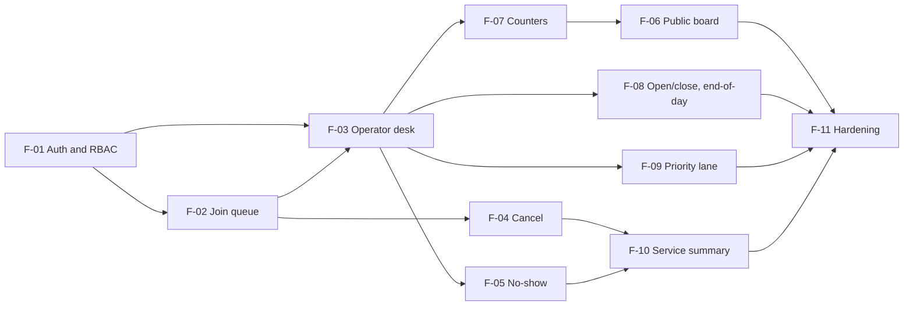

# Feature Inventory: Bank Branch Queue System

Version 1.0 (5 Nov 2026). Requirement definitions are in `docs/srs.md`. The requirement-to-feature-to-test mapping is in `docs/traceability.md`. Sprint allocation and rationale are in `docs/sprints/plan.md`.

## 1. Feature summary

| ID | Feature | Sprint | Primary actor | Covers (FR / BR / NFR) | Depends on |
|---|---|---|---|---|---|
| F-01 | Auth and RBAC | 1 | Customer, Operator | FR-01; NFR-01, NFR-02, NFR-07 | none |
| F-02 | Join queue and my ticket | 1 | Customer | FR-02, FR-03; BR-01, BR-02, BR-08, BR-09, BR-10; NFR-03 | F-01 |
| F-03 | Operator service desk | 1 | Operator | FR-04, FR-05, FR-13; BR-03, BR-04, BR-05, BR-06, BR-07; NFR-04 | F-01, F-02 |
| F-04 | Customer cancel | 2 | Customer | FR-06; BR-11 | F-02 |
| F-05 | No-show handling | 2 | Operator | FR-07; BR-12 | F-03 |
| F-06 | Public board | 2 | Anyone | FR-08; NFR-05 | F-07 |
| F-07 | Counters | 2 | Operator | FR-09; BR-13 | F-03 |
| F-08 | Queue open/close and end-of-day | 2 | Operator | FR-12; BR-16 (extends BR-09) | F-03 |
| F-09 | Priority lane | 3 (starts first) | Customer, Operator | FR-10; BR-14, BR-15 | F-03 (and F-07 for stable call-next) |
| F-10 | Service summary | 3 | Operator | FR-11 | F-04, F-05 |
| F-11 | Hardening | 3 | all | NFR-04 (GCP), NFR-06; regression, UX and error handling | all |

Enabling work that is not a feature (no FR/BR): documentation baseline (Issue #1), Sprint 1 contracts (Issue #2) and the monorepo scaffold (Issue #3). They are listed in `docs/sprints/plan.md`.

## 2. Feature descriptions

### F-01 Auth and RBAC (Sprint 1)

Real authentication and server-side role enforcement for the two roles `CUSTOMER` and `OPERATOR`.

- **Behavior:** login with username and password creates a database session and an HttpOnly cookie; `GET /api/auth/me` returns the current user from the cookie only; logout deletes the session; expired sessions are rejected and removed.
- **Rules and boundaries:** wrong password and unknown username give the identical 401 response; passwords are stored as argon2id hashes; every protected endpoint returns 401 without a valid session and 403 for the wrong role.
- **Screens:** `/login`, role-based redirect after login (customer to `/queues`, operator to `/operator`), route guard that redirects anonymous visitors to `/login`.
- **Out of feature:** registration, password reset, account administration (excluded in the SRS).
- **Provides to others:** the session guard and roles guard used by every later feature.

### F-02 Join queue and my ticket (Sprint 1)

A customer lists the queues, joins an open one and follows their own ticket.

- **Behavior:** the join assigns the next sequence number of the queue for today in a single transaction and returns the display number (for example `D001`), status WAITING, lane REGULAR and people ahead. `/my-ticket` shows number, status and people ahead and refreshes every 5 seconds.
- **Rules and boundaries:** one active entry per customer per queue per day (BR-02) but several queues at once are allowed; a closed queue rejects the join with `QUEUE_CLOSED` (BR-09); numbers are unique under 20 concurrent joins (BR-01, NFR-03); numbering restarts at local midnight (BR-10); no financial or national-ID data is stored (BR-08).
- **Permissions:** only customers can join; an operator gets 403. A customer can read only their own entry; another customer's entry returns 404.

### F-03 Operator service desk (Sprint 1)

An operator calls and serves customers from the queues assigned to them.

- **Behavior:** `/operator` lists the assigned queues with waiting counts and shows the entry the operator currently holds. Call next moves the lowest-sequence WAITING entry to CALLED; Start moves CALLED to SERVING; Complete moves SERVING to COMPLETED. The held entry is restored after a page refresh.
- **Rules and boundaries:** only assigned queues (BR-05); at most one CALLED or SERVING entry per operator (BR-06); only the operator who called an entry may start or complete it, otherwise `NOT_ENTRY_OWNER` (BR-07); invalid transitions are rejected without changing data (BR-04); two operators calling at the same time never receive the same entry; call-next with nothing waiting returns `NO_WAITING_ENTRY`.
- **Persistence:** completed entries survive an API restart (NFR-04).
- **Extension points built now:** the `QueueOrderingPolicy` interface (FIFO in Sprint 1) so that the priority lane in Sprint 3 is an addition rather than a rewrite.

### F-04 Customer cancel (Sprint 2)

A customer cancels their own WAITING or CALLED entry from `/my-ticket` (BR-11). Operators do not cancel; they use no-show (F-05). Cancelling frees the customer to join the same queue again the same day.

### F-05 No-show handling (Sprint 2)

An operator marks an entry they called as NO_SHOW. The rule is time-based: allowed only after the grace period since the call (BR-12, default 2 minutes, see SRS Q-02). Uses the injected Clock so the boundary is testable. UI action on `/operator`.

### F-06 Public board (Sprint 2)

A public screen `/board` (large text, auto-refresh) shows, per queue, the numbers now being served with counter labels and the waiting count. No authentication. The response contains no names, usernames or customer IDs (NFR-05). Depends on F-07 for counter labels.

### F-07 Counters (Sprint 2)

Named counters per queue. Call-next accepts an optional `counterId` (D-22); when given, the entry records the counter and a counter may hold at most one CALLED or SERVING entry (BR-13). Adds migration 002 and the counter selector on `/operator`. Contract v2 of F-03 records the optional parameter.

### F-08 Queue open/close and end-of-day (Sprint 2)

An operator opens or closes an assigned queue (closed queues reject joins, existing entries still served, BR-09). End-of-day closes the queue and sets that day's remaining WAITING and CALLED entries to EXPIRED and returns the count (BR-16).

### F-09 Priority lane (Sprint 3, scheduled first)

Senior customers (age 60 or more on the join date, see SRS Q-01) are placed in the PRIORITY lane by the server from the stored date of birth; no request field can set the lane (BR-15). PRIORITY entries are called before REGULAR ones, FIFO inside each lane, with an anti-starvation rule after 3 consecutive priority calls (BR-14). Call-next locks the queue row so concurrent operators keep the count correct. Priority is shown as a badge on `/my-ticket`, `/operator` and `/board`, not as a different number.

### F-10 Service summary (Sprint 3)

An operator views, for an assigned queue and date range, the served count, average wait, average service time, no-show count and cancel count (FR-11). A table on `/operator/summary` is sufficient. Depends on F-04 and F-05 because it counts cancel and no-show outcomes.

### F-11 Hardening (Sprint 3)

Cross-cutting completion work: an access sweep (401, 403 and 404 verified for every Sprint 2 and 3 endpoint), the NFR-06 latency measurement, the NFR-04 persistence check on the GCP deployment, friendly error and empty states, and a final regression run.

## 3. Dependency graph

## 4. Cross-cutting responsibilities

Some requirements are not owned by a single feature. Each has a named responsibility, an establishing sprint and a verification point.

| Responsibility | Requirements | Established in | Verified in |
|---|---|---|---|
| Backend authentication and authorization (session guard, roles guard) | FR-01, NFR-01 | F-01, Sprint 1 | Sprint 1 table-driven 401 test (AC-06); extended to every new endpoint in each sprint and swept in F-11 |
| Password hashing | NFR-02 | F-01, Sprint 1 | Sprint 1 integration test (AC-07) |
| Persistence, migrations and reproducible seed | NFR-04, BR-08 | Scaffold (Issue #3) and F-03, Sprint 1 | Restart test (AC-29) in Sprint 1; deployment persistence check in Lab 5 and Sprint 2 |
| Configuration and secrets (`.env.example`, no secrets in Git) | NFR-07 | Scaffold (Issue #3), Sprint 1 | Review checklist at each release (manual) |
| Time handling through the injected Clock | BR-10, BR-12, BR-15 | Scaffold (Issue #3), Sprint 1 | Fixed-Clock tests (AC-15 in Sprint 1; grace period in Sprint 2; age boundary in Sprint 3) |
| Error format and input validation | all | Scaffold (Issue #3), Sprint 1 | Asserted by the API tests of each feature |
