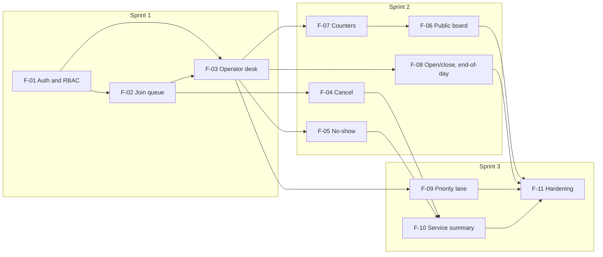

# Three-Sprint Plan: Bank Branch Queue System

Version 1.1 (27 Nov 2026; 1.0 5 Nov 2026). Version 1.1 adds section 10, which records how the actual Sprint 2 and Sprint 3 work differs from this plan. Sections 1 to 9 are the plan as approved on 5 Nov and are not rewritten. Features are defined in `docs/features.md`; requirement coverage is in `docs/traceability.md`.

## 1. Overview

| Sprint | Goal | Features | Window | Checkpoint | Release tag |
|---|---|---|---|---|---|
| 1 | A working vertical slice with authentication, permissions, persistence and the core queue rules | F-01, F-02, F-03 | 5 to 8 Nov | Deliverable 1, Sun 8 Nov | `v0.1.0-sprint1` |
| 2 | Complete the queue lifecycle and the branch-floor experience | F-04, F-05, F-06, F-07, F-08 | 9 to 23 Nov | Complete before Deliverable 2, Sun 29 Nov | `v0.2.0-sprint2` |
| 3 | Priority lane, reporting and hardening | F-09 (implemented and tested before 29 Nov), F-10, F-11 | 23 Nov to 13 Dec | Progress at 29 Nov (release candidate `v0.3.0-rc1`); complete on Sun 13 Dec | `v1.0.0` |

Together the three sprints cover all 36 baseline requirements: 21 in Sprint 1, 10 in Sprint 2 and 5 in Sprint 3 (see `docs/traceability.md`).

## 2. Feature dependencies

| Dependency | Why |
|---|---|
| F-01 before everything | Every feature needs the session and role guards |
| F-02 before F-03 | The operator needs entries to call |
| F-03 before F-05, F-07, F-08, F-09 | They extend the call and serve flow |
| F-07 before F-06 | The board shows counter labels |
| F-04 and F-05 before F-10 | The summary counts cancel and no-show outcomes |
| All before F-11 | Hardening sweeps and regression cover every feature |

## 3. Sprint 1: working vertical slice (5 to 8 Nov)

**Goal.** A customer logs in, joins a queue and sees their number; an operator logs in, calls, starts and completes service; every rule, permission and persistence claim is backed by automated tests.

**Included features.** F-01 Auth and RBAC, F-02 Join queue and my ticket, F-03 Operator service desk (30 acceptance criteria, AC-01 to AC-30).

**Why this scope.** It is the smallest slice that satisfies the Deliverable 1 requirements: a complete domain journey through UI, API and database; real login, logout and two roles; a meaningful state transition with rule validation (duplicate active entry, invalid transition, ownership); and tests for rules, persistence and access.

**Deliberately not in Sprint 1.** Cancel, no-show, counters, public board, open/close, priority, summary, Docker packaging of the app, CI/CD and cloud deployment (Lab 5). Migration 001 already contains all statuses and the `lane` column so later sprints add behavior, not schema churn.

**Work items.** Issue numbers on the project board differ from the plan numbers; both are shown.

| Plan Issue | GitHub Issue | Work | Branch | Depends on | Author / Reviewer | Target |
|---|---|---|---|---|---|---|
| 1 | #4 | Docs: SRS, features, traceability, system SDS, plan (Parts A to D) | `docs/baseline` | none | A / B | Thu 5 Nov |
| 2 | #5 | Docs: Sprint 1 contracts F-01 to F-03, STS, Product DoD (Part E) | `docs/sprint-1-contracts` | none | B / A | Thu 5 Nov |
| 3 | #6 | Scaffold: monorepo, docker-compose, migration 001, seed, test harness | `chore/scaffold` | none | A / B | Thu 5 Nov |
| 4 | #7 | F-01 Auth and RBAC, full stack | `feature/F-01-auth` | Issues 2, 3 | B / A | Fri 6 Nov |
| 5 | #9 | F-02 Join queue and my ticket, full stack (test-first: AC-11) | `feature/F-02-join-queue` | Issues 2, 3; merge staging after Issue 4 | A / B | Sat 7 Nov |
| 6 | #10 | F-03 Operator service desk, full stack (test-first: AC-26) | `feature/F-03-service-desk` | Issue 4; merge staging after Issue 5 | B / A | Sat 7 Nov |
| 7 | #11 | Release: README, evidence, contributions, AI-use declaration, release PR to `main`, tag | `docs/sprint-1-evidence`, then `sprint-1-staging` to `main` | Issues 4 to 6 | A / B | Sun 8 Nov |

**Completion criteria (Sprint 1 is done when all are true).**
1. All 30 AC have a test that exists, runs and passes on `sprint-1-staging`; any failed or skipped test is disclosed.
2. The test-first evidence (failing then passing output) is saved for AC-11 and AC-26.
3. The contract documents (Part E) were merged into staging before the first implementation commit of each feature.
4. Every feature PR was reviewed by the other student with a specific finding, and merged with a merge commit.
5. The release PR to `main` is reviewed and merged, the annotated tag `v0.1.0-sprint1` exists and its full commit SHA is recorded.
6. Build and tests were run from a clean checkout of the tag and the outputs saved.
7. README setup works on a clean machine; no secrets are committed.
8. Feature freeze at Sun 8 Nov 12:00; the PDF is submitted by Sun 8 Nov 21:00 (deadline 23:59).

**Feasibility.** Two students, four days, seven work items. Features are full-stack single Issues (API, web and tests in one PR) to limit review round-trips. A draft PR is opened on the first push so review overlaps with work; the reviewer responds within 2 hours; the author starts the next Issue while a PR waits.

**If Sprint 1 falls behind, cut in this order.** Merge E2E-01 into E2E-02; mark AC-05 (session expiry), AC-12 (two queues) and AC-29 (restart) as "planned, not executed" with an honest note in Part F; replace status polling with a Refresh button; simplify styling. Never cut authentication and permission tests, AC-11, AC-14, AC-24 and AC-26.

## 4. Sprint 2: lifecycle expansion and branch floor (9 to 23 Nov)

**Goal.** Complete the customer and operator lifecycle and the physical-branch experience.

**Included features.** F-04 Customer cancel, F-05 No-show, F-06 Public board, F-07 Counters, F-08 Queue open/close and end-of-day.

**Dependencies.** Starts from the `v0.1.0-sprint1` tag; `sprint-2-staging` is created from `main` at the tag. Contracts for F-04 to F-08 (including F-03 contract v2 for the optional `counterId`, D-22) are merged before implementation. F-07 precedes F-06.

**Work items.**

| Plan Issue | Work | Depends on | Target |
|---|---|---|---|
| 8 | Docs: Sprint 2 contracts F-04 to F-08, STS, DoD, F-03 contract v2 | Sprint 1 tag | Tue 10 Nov |
| 9 | F-07 Counters and F-06 Public board (migration 002, `call-next` with counter, `/board`) | Issue 8 | Wed 18 Nov |
| 10 | F-04 Cancel and F-05 No-show (test-first: BR-12 grace period) | Issue 8 | Mon 16 Nov |
| 11 | F-08 Open/close and end-of-day | Issue 8; merge staging after Issue 10 | Fri 20 Nov |
| 12 | Release: Sprint 2 evidence, full regression, release PR, tag `v0.2.0-sprint2`, deploy | Issues 9 to 11 | Mon 23 Nov |

**Completion criteria.** All Sprint 2 AC have passing tests; the full Sprint 1 and Sprint 2 regression suite is green on staging; NFR-05 (no personal data on the board) is verified; the release is tagged and deployed on GCP and data persists across redeployment (NFR-04); the Sprint 2 contracts were merged before implementation.

## 5. Sprint 3: priority, reporting and hardening (23 Nov to 13 Dec)

**Goal.** Add the standout business rule (priority lane for seniors), reporting, and finish hardening for the final release.

**Included features.** F-09 Priority lane (starts first), F-10 Service summary, F-11 Hardening.

**Dependencies.** F-09 needs a stable call-next flow (F-03) and counters (F-07). F-10 needs F-04 and F-05. F-11 needs everything. Sprint 3 contracts are written by 22 Nov (Issue 13).

**Work items.**

| Plan Issue | Work | Depends on | Target |
|---|---|---|---|
| 13 | Docs: Sprint 3 contracts F-09 to F-11, STS, DoD | Issue 8 | Sun 22 Nov |
| 14 | F-09 Priority lane (test-first) | Sprint 2 tag, Issue 13 | Wed 25 Nov |
| 15 | Release candidate for Deliverable 2: regression, evidence, tag `v0.3.0-rc1`, deploy | Issue 14 | Fri 27 Nov |
| 16 | F-10 Service summary | Issue 15 | Mon 30 Nov |
| 17 | F-11 Hardening: access sweep, NFR-06 latency script, error and empty states | Issue 15 | Mon 30 Nov |
| 18 | Final release: UAT re-tests, final regression, tag `v1.0.0`, deploy, demo video, final PDF | Issues 16, 17, defect fixes | Sun 13 Dec |

**Completion criteria.**
- *At Deliverable 2 (29 Nov):* Sprint 2 complete and released; F-09 implemented and tested; Sprint 3 contracts merged; deployed release candidate; an explicit list of remaining work.
- *At final delivery (13 Dec):* F-10 and F-11 complete; all 36 requirements verified or their status disclosed; the final regression passes on the final commit; UAT defects are fixed and re-tested; `v1.0.0` is deployed; no new features are added during the exam period (1 to 11 Dec); only defect fixes and the final release.

## 6. Rationale for deferring the priority lane to Sprint 3

1. **It changes call order.** The priority lane modifies the call-next selection, which first has to exist and be stable (F-03 in Sprint 1, counters in Sprint 2). Building it earlier would mean changing the ordering while its basic behavior is still being verified.
2. **It is an addition, not a rewrite.** Sprint 1 already contains the customer's `date_of_birth`, the `lane` column (default REGULAR) and the `QueueOrderingPolicy` interface with a FIFO implementation. Sprint 3 only adds `PriorityOrderingPolicy` and the queue-row lock.
3. **Sprint 1 must stay small and finishable.** Deliverable 1 needs a working, fully tested slice in four days. Priority adds eligibility rules, an anti-starvation rule and concurrency tests that would put the baseline at risk.
4. **It is not postponed until late.** The course requires at least one Sprint 3 rule to be implemented and tested by Deliverable 2 (29 Nov). F-09 therefore starts first in Sprint 3, immediately after the Sprint 2 tag, and the release candidate is tagged on 27 Nov.
5. **It must not be the Lab 7 change.** Lab 7 requires changing behavior that is already implemented, and a backlog feature does not count; the Lab 7 change candidates are chosen from implemented behavior instead.

Other sequencing choices: cancel and no-show precede the summary because the summary reports their outcomes; hardening is last because it sweeps all endpoints.

## 7. Risks and mitigations

| Risk | Mitigation |
|---|---|
| Sprint 1 falls behind before the 8 Nov deadline | Cut order in section 3; feature freeze at 12:00 on 8 Nov; three hours of submission buffer |
| Review latency between two students | Draft PRs, 2-hour review target, never wait idle |
| Lab work (Docker, CI, deployment, UAT fixes) competes with Sprint 2 | Lab items have their own Issues and labels; they reach `main` as patch releases (D-24); staging is kept releasable |
| Deployment on 11 Nov needed for partner UAT (SRS Q-09) | Fallback: documented local run of the Sprint 1 tag |
| Exam period (1 to 11 Dec) | No new features; everything except defect fixes and the final release is merged by 30 Nov |
| Assumed rules not yet confirmed (SRS Q-01, Q-02) | Working defaults are configurable by environment variables; confirmations recorded as decisions |

## 8. Related lab work (kept separate from feature work)

| Lab | Due | Work | Release |
|---|---|---|---|
| Lab 5 | 15 Nov | Docker, CI/CD, GCP deployment of the Sprint 1 release | `v0.1.1` (deployed by 11 Nov) |
| Lab 6 | 22 Nov | UAT cases and handoff; execute the partner's UAT; fix accepted defects | `v0.1.2` if needed |
| Lab 7 | 29 Nov | Approved change to already implemented behavior, impact analysis, regression, metrics | `v0.2.1` |

Lab evidence cites its own PR, tag and deployment, separate from sprint feature evidence.

## 9. Change control

A change to scope, feature allocation or sprint dates is recorded in the change table of `docs/traceability.md` (section 5.2) and in the SRS decision log with the date, the reason and the affected IDs. History is never rewritten.

## 10. Plan changes (recorded 27 Nov 2026)

The feature scope and allocation did not change: Sprint 2 is still F-04 to F-08 and Sprint 3 is still F-09 to F-11. Dates, branches, tags and the Issue breakdown changed.

| ID | Planned (sections 1, 4, 5) | Actual | Reason | Decision |
|---|---|---|---|---|
| PROC-03 | Sprint 2 from 9 to 23 Nov, Issues 8 to 12, tag `v0.2.0-sprint2` on 23 Nov | Contracts merged 27 Nov (PR #51); F-04, F-05, F-08 (PR #53) and F-07, F-06 (PR #52) built and merged 26–27 Nov; released 27 Nov as `v0.4.0-sprint2` (`8c5f638`, PR #55) | Lab 5, Lab 6 and Lab 7 work (deployment, UAT, CR-01) took the planned Sprint 2 time | Disclosed in the Deliverable 2 PDF |
| BR-1 | `sprint-2-staging` created from `main` at the Sprint 1 tag | `sprint-2-staging` created 27 Nov from `faca7fb` (the `Lab5-staging` head, which already contained the lab work); `sprint-3-staging` created 27 Nov from `main` at `8c5f638` | The lab work had to stay in the Sprint 2 baseline | D-25 |
| TAG-1 | Tags `v0.1.0-sprint1`, `v0.2.0-sprint2`, `v0.3.0-rc1`, `v1.0.0`; lab patch releases `v0.1.1`, `v0.1.2`, `v0.2.1` (D-24) | Labs released as `v0.2.0-lab5` and `v0.3.0-lab7`; Sprint 2 `v0.4.0-sprint2`; release candidate `v0.5.0-rc1`; `v0.1.0-sprint1` pushed late on 27 Nov on `0a2d8fe` | The planned version numbers were already used by the lab releases | D-26 |
| ISS-1 | Sprint 2: 5 Issues (8 to 12); Sprint 3 up to 29 Nov: Issues 13 to 15 | 6 Issues for both: S2-1 contracts (Sprint 2 and 3), S2-2 F-07 + F-06, S2-3 F-04 + F-05 + F-08, S2-4 Sprint 2 release, S3-1 F-09, S3-2 docs baseline + release candidate | Fewer PRs and review rounds in the shorter time; both students still worked in parallel on separate files | – |
| S3-1 | F-09 by Wed 25 Nov; release candidate on Fri 27 Nov | F-09 merged 27 Nov (PR #56, TDD TEST-57); release candidate `v0.5.0-rc1` planned 28 Nov | Follows the Sprint 2 delay | – |
| S3-2 | F-10 and F-11 by Mon 30 Nov; final release 13 Dec | Unchanged; the dated plan is in `docs/sprints/sprint-3/remaining-work.md` | | – |
