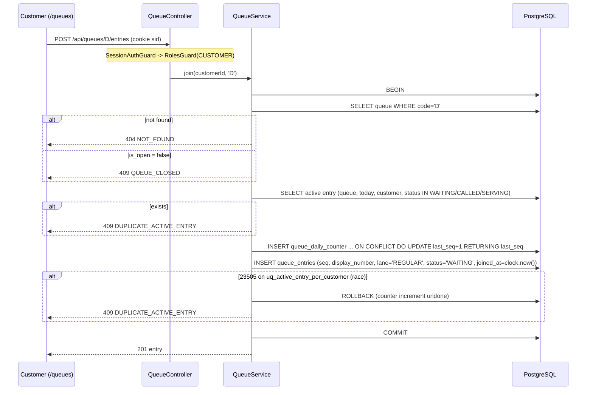
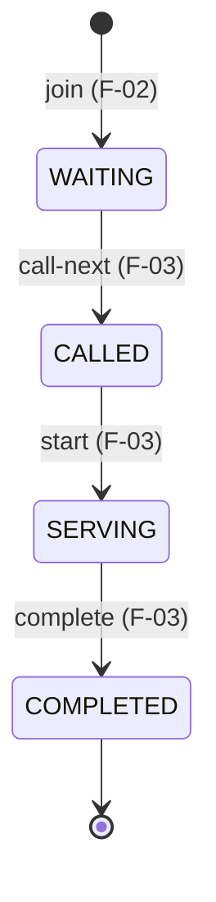

# F-02 Join Queue & My Ticket - Feature Contract

**Contract v1 - 2026-11-06**
**Feature:** F-02 Join queue & my ticket (Sprint 1)
**Requirements:** FR-02, FR-03; BR-01, BR-02, BR-08, BR-09, BR-10; NFR-03
**Decisions used:** D-01, D-02, D-03, D-06, D-07, D-08, D-11, D-13, D-15, D-16, D-20
**Acceptance criteria:** AC-09..AC-18 - **Tests:** TEST-09..TEST-18 (TEST-18 in E2E-02), UT-02, UT-03
**TDD:** AC-11 / TEST-11 (failing test committed and its red output saved before the implementation)
**Implementation Issue:** #9 `feature/F-02-join-queue` (author SinghLemonH, reviewer WATHITx)
**Depends on:** F-01 guards (merge `sprint-1-staging` into the branch after #7 lands). Domain code and failing tests can start before that.

Shared conventions are in [README.md](README.md) section 3. Scaffold fix owned by this feature: SA-8 (entry constraint mapping).

---

## 1. Purpose and behavior

A signed-in **customer** sees the bank's service queues (Deposit & Withdrawal `D`, Loans `L`, Account Opening `O`) with how many people are waiting, joins one, and receives a display number such as `D001`. The customer then sees their ticket(s) for today with status and how many people are ahead. Operators can list queues but cannot join.

### 1.1 Join workflow (one database transaction)



Steps in detail (system SDS 2.4 "Join"):
1. Load the queue by code. Missing -> 404 `NOT_FOUND`. `is_open = false` -> 409 `QUEUE_CLOSED`.
2. `queueDate = clock.today()` (Asia/Bangkok).
3. Pre-check: an entry for (queue, queueDate, customer) with status WAITING/CALLED/SERVING exists -> 409 `DUPLICATE_ACTIVE_ENTRY`.
4. Increment the daily counter with the upsert, get `seq`.
5. Insert the entry: `seq`, `display_number = formatDisplayNumber(code, seq)`, `lane = 'REGULAR'`, `status = 'WAITING'`, `joined_at = clock.now()`, `operator_id = NULL`.
6. A `23505` on `uq_active_entry_per_customer` (two joins from the same customer racing) is mapped to `DUPLICATE_ACTIVE_ENTRY`. The rollback also removes the counter increment, so numbers have no gaps.

**All queries in steps 1-5 go through the transaction's `EntityManager`/`QueryRunner`.** A repository call on the default pool inside the transaction can exhaust the pool and deadlock TEST-14.

### 1.2 Entry lifecycle seen by the customer (Sprint 1)


CANCELLED, NO_SHOW and EXPIRED exist in the schema (D-15) but are not reachable in Sprint 1.

## 2. Business rules, validation and boundary cases

| # | Rule / case | Expected behavior | Verified by |
|---|---|---|---|
| BR-01 | Display numbers unique per queue per day, also under concurrent joins | counter upsert + `uq_entry_number (queue_id, queue_date, seq)` | TEST-14 |
| BR-02 | At most one active (WAITING/CALLED/SERVING) entry per customer per queue per day | 409 `DUPLICATE_ACTIVE_ENTRY`; still exactly one active row | TEST-11 (TDD) |
| BR-02 scope | A customer may be active in **different** queues at once | D and L both 201 | TEST-12 |
| BR-02 scope | After the entry reaches a terminal status (COMPLETED) the customer may join the same queue again the same day | 201 with the next number (`D002`) | TEST-12 (extra case) |
| BR-02 / D-13 | An active entry from an **earlier** `queue_date` never blocks today | join today -> 201 `D001` | TEST-15 |
| BR-08 | No financial or national-ID data | entry has only queue, customer, lane, status, operator, timestamps; response has no customer id/name | manual check (dod.md 1A, per traceability 5.1); supporting key assertion in TEST-10 |
| BR-09 | Closed queue rejects joins | 409 `QUEUE_CLOSED`; no row; counter unchanged | TEST-13 |
| BR-09 order | Closed **and** customer already active | `QUEUE_CLOSED` wins (closed check runs first) | - (design note) |
| BR-10 | Numbering restarts at `001` at Asia/Bangkok midnight; queues are independent | first entry of each Bangkok date is `001`, per queue | TEST-15, UT-03 |
| D-01 | Display number format | `code + seq` padded to 3 digits: `D001`, `D010`, `D999`, `D1000` | UT-02 |
| NFR-03 | 20 concurrent joins to one queue | 20 distinct numbers, seq 1..20 | TEST-14 |
| V1 | Unknown queue code (e.g. `Z`) or lower-case code (`d`) | 404 `NOT_FOUND` (codes are exact upper-case) | TEST-13 (extra case) |
| V2 | Join takes **no request body** | any body (e.g. `{"lane":"PRIORITY","customerId":"..."}`) is ignored; the lane is always `REGULAR` and the customer is always the cookie user | TEST-10 (extra case) |
| V3 | `GET /api/entries/:id` with a non-UUID id | 404 `NOT_FOUND` (no 400/500) | TEST-16 (extra case) |
| V4 | `peopleAhead` | count of WAITING entries in the same queue and `queue_date` with a lower `seq`; `null` when the entry is not WAITING | TEST-10, TEST-16 |
| V5 | `waitingCount` | WAITING entries of today's `queue_date` only | TEST-09 |

## 3. Permissions

| Operation | Anonymous | Customer | Operator |
|---|---|---|---|
| `GET /api/queues` | 401 | yes | yes |
| `POST /api/queues/:code/entries` | 401 | yes (as self) | 403 `FORBIDDEN` |
| `GET /api/me/entries` | 401 | own only | 403 `FORBIDDEN` |
| `GET /api/entries/:id` | 401 | own -> 200; another customer's -> 404 `NOT_FOUND` (D-07) | 403 `FORBIDDEN` |

Returning 404 (not 403) for another customer's entry does not reveal that the entry exists.

## 4. API specification

Entry and queue shapes: README 3.4.

### 4.1 `GET /api/queues` (any signed-in user)
200:
```json
[
  { "code": "D", "name": "Deposit & Withdrawal", "isOpen": true,  "waitingCount": 2 },
  { "code": "L", "name": "Loans",                "isOpen": true,  "waitingCount": 0 },
  { "code": "O", "name": "Account Opening",      "isOpen": false, "waitingCount": 0 }
]
```
Ordered by `code`. Errors: 401.

### 4.2 `POST /api/queues/:code/entries` (CUSTOMER)
No request body. 201:
```json
{ "id": "uuid", "queueCode": "D", "displayNumber": "D001", "status": "WAITING", "lane": "REGULAR",
  "peopleAhead": 0, "joinedAt": "2026-11-06T02:00:00.000Z", "calledAt": null, "startedAt": null, "endedAt": null }
```

| Status | Code | When |
|---|---|---|
| 401 | `UNAUTHENTICATED` | no/invalid session |
| 403 | `FORBIDDEN` | caller is an OPERATOR |
| 404 | `NOT_FOUND` | unknown queue code |
| 409 | `QUEUE_CLOSED` | `is_open = false` |
| 409 | `DUPLICATE_ACTIVE_ENTRY` | customer already active in this queue today |

### 4.3 `GET /api/me/entries` (CUSTOMER)
200: array of the caller's entries whose `queue_date` is today (all statuses), ordered by `joinedAt` ascending. `[]` when none. Errors: 401, 403.

### 4.4 `GET /api/entries/:id` (CUSTOMER, own)
200: the entry (any date). Errors: 401, 403 (operator), 404 `NOT_FOUND` (missing, malformed id, or another customer's).

## 5. UI specification

### 5.1 `/queues` (customer home)
- One card/row per queue: name, code, **Open/Closed** badge, "N waiting", **Join** button.
- **Join** is disabled for closed queues (UX only; the API rejects anyway) and while a join is in progress ("Joining...").
- **Success:** navigate to `/my-ticket`.
- **Loading:** skeleton or "Loading queues...". **Empty:** "No service queues are available." **Error:** message from `lib/errors.ts` + Retry button.
- Error messages (added to `lib/errors.ts`):

| Code | Message (EN) | Message (TH) |
|---|---|---|
| `DUPLICATE_ACTIVE_ENTRY` | You already have an active ticket in this queue today. | คุณมีบัตรคิวที่ยังใช้งานอยู่ในคิวนี้แล้ววันนี้ |
| `QUEUE_CLOSED` | This queue is closed. Please choose another service. | คิวนี้ปิดให้บริการแล้ว กรุณาเลือกบริการอื่น |
| `NOT_FOUND` | This queue no longer exists. | ไม่พบคิวนี้ |
| `FORBIDDEN` | Only customers can join a queue. | เฉพาะลูกค้าเท่านั้นที่สามารถรับบัตรคิวได้ |

After `DUPLICATE_ACTIVE_ENTRY`, also show a link "View my ticket" to `/my-ticket`.

### 5.2 `/my-ticket`
- Data: `GET /api/me/entries`, refreshed **every 5 seconds** (polling stops when the page is hidden or unmounted).
- One ticket card per entry: large display number, queue name/code, status label, and "People ahead: N" when WAITING.
- Status labels:

| Status | EN | TH |
|---|---|---|
| WAITING | Waiting | รอเรียก |
| CALLED | Called - please go to the counter | ถึงคิวแล้ว กรุณาไปที่เคาน์เตอร์ |
| SERVING | Being served | กำลังให้บริการ |
| COMPLETED | Completed | เสร็จสิ้น |

- **Empty:** "You have no ticket today." with a link to `/queues`. **Loading:** first load only (polling refreshes silently). **Error:** keep the last data, show a small "Could not refresh" note.

## 6. Data specification

**No schema change.** Migration 001 already has every column (including `lane` and all statuses, D-15).

| Table | Fields used | Constraints relied on |
|---|---|---|
| `queues` | `id`, `code`, `name`, `is_open` | `code UNIQUE`, `CHECK code ~ '^[A-Z]$'` |
| `queue_daily_counter` | `queue_id`, `queue_date`, `last_seq` | PK `(queue_id, queue_date)`, `last_seq >= 0` |
| `queue_entries` | all columns | `uq_entry_number (queue_id, queue_date, seq)` (BR-01); partial unique index `uq_active_entry_per_customer (queue_id, queue_date, customer_id) WHERE status IN ('WAITING','CALLED','SERVING')` (BR-02); `seq > 0`; index `ix_entries_customer` |

Postgres error mapping (SA-8, `infrastructure/pg-errors.ts`): `23505` + constraint `uq_active_entry_per_customer` -> `DuplicateActiveEntryError`. Any other `23505` is rethrown (500), never silently swallowed.

TypeORM entities added: `QueueEntity`, `QueueEntryEntity`, `QueueDailyCounterEntity` (mapping only).

## 7. Implementation outline (non-binding guidance for Issue #9)

| Layer | Item |
|---|---|
| domain | `display-number.ts` `formatDisplayNumber(code, seq)`; `queue-entry.ts` (status/lane types); `peopleAhead` rule |
| application | `queue.service.ts`: `listQueues()`, `join(customerId, code)` (transaction), `myEntriesToday(customerId)`, `getOwnEntry(customerId, id)` |
| infrastructure | entities above, `pg-errors.ts` |
| presentation | `queue.controller.ts` (`GET /queues`, `POST /queues/:code/entries`), `entry.controller.ts` (`GET /me/entries`, `GET /entries/:id`), `ParseUUIDPipe`-style id check that returns 404 |
| web | `/queues`, `/my-ticket`, codes in `lib/errors.ts` |
| tests | append the four endpoints to the TEST-06 table |

TDD order: `test(F-02): TEST-11 failing - duplicate active entry` -> save red output to `docs/sprints/sprint-1/evidence/TEST-11-red.txt` -> `feat(F-02): reject duplicate active entry (BR-02)` -> save `TEST-11-green.txt`.

## 8. Acceptance criteria

| AC | Expected outcome | Level | Test |
|---|---|---|---|
| AC-09 | `GET /api/queues` -> `[{code, name, isOpen, waitingCount}]` for any logged-in user. | API | TEST-09 |
| AC-10 | Customer joins open queue D -> 201 `{id, queueCode:'D', displayNumber:'D001', status:'WAITING', lane:'REGULAR', peopleAhead:0}`; the row exists in the DB. | API | TEST-10 |
| AC-11 ★TDD | Second join to the same queue on the same day while active -> 409 `DUPLICATE_ACTIVE_ENTRY`; still exactly one active row. | API | TEST-11 |
| AC-12 | The same customer can join D and L at the same time -> both 201. | API | TEST-12 |
| AC-13 | Join a closed queue -> 409 `QUEUE_CLOSED`; no row inserted; counter unchanged. | API | TEST-13 |
| AC-14 | 20 different customers join D concurrently -> 20 rows with seq 1..20, no duplicates. | API | TEST-14 |
| AC-15 | First entry of a Bangkok date is `001`; the next Bangkok date restarts at `001`; queues number independently. | API (fixed Clock) + unit | TEST-15, UT-02, UT-03 |
| AC-16 | `GET /api/entries/:id`: own -> 200 with `peopleAhead`; another customer's -> 404 `NOT_FOUND`; operator -> 403. | API | TEST-16 |
| AC-17 | Operator `POST /api/queues/D/entries` -> 403 `FORBIDDEN`. | API | TEST-17 |
| AC-18 | UI: customer joins from `/queues`, lands on `/my-ticket` showing number, status and people ahead; status refreshes every 5 s; a duplicate join shows a friendly message. | E2E | TEST-18 (E2E-02) |

Negative / boundary / role coverage: AC-11 (rule), AC-13 (closed), AC-14 (concurrency), AC-15 (midnight boundary), AC-16 (ownership), AC-17 (role).

## 9. Version history

| Version | Date | Author | Change | Reason |
|---|---|---|---|---|
| v1 | 2026-11-06 | WATHITx | Initial contract (Issue #5) | Contract before code |
