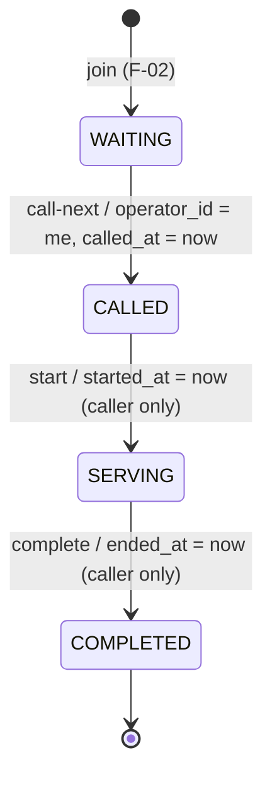

# F-03 Operator Service Desk - Feature Contract

**Contract v1 - 2026-11-06**
**Feature:** F-03 Operator service desk (Sprint 1)
**Requirements:** FR-04, FR-05, FR-13; BR-03, BR-04, BR-05, BR-06, BR-07; NFR-04
**Decisions used:** D-02, D-04, D-05, D-07, D-13, D-14, D-15, D-16, D-20, D-21, D-22
**Acceptance criteria:** AC-19..AC-30 - **Tests:** TEST-19..TEST-30 (TEST-30 in E2E-02), UT-01, UT-04
**TDD:** AC-26 / TEST-26 + UT-01 (failing tests committed and red output saved before the implementation)
**Implementation Issue:** #10 `feature/F-03-service-desk` (author WATHITx, reviewer SinghLemonH)
**Depends on:** F-01 (guards). E2E-02 needs F-02: merge `sprint-1-staging` into the branch after #9 lands.

Shared conventions are in [README.md](README.md) section 3. Scaffold fixes owned by this feature: SA-3 (assignment -> `FORBIDDEN`), SA-8 (operator constraint mapping).

---

## 1. Purpose and behavior

A signed-in **operator** (teller, loan officer, account officer) sees the queues assigned to them with waiting counts, calls the next waiting customer, starts service and completes it. The operator page always recovers the entry the operator is holding, so a refresh never loses it. Customers see the new status on their ticket.

### 1.1 State machine (Sprint 1 transitions only, D-04)



Transition table (`domain/entry-status.ts`). Every pair not marked "allowed" is rejected with 409 `INVALID_TRANSITION` and no data change (BR-04).

| From \ Action | call | start | complete |
|---|---|---|---|
| WAITING | allowed -> CALLED | 409 | 409 |
| CALLED | 409 | allowed -> SERVING | 409 |
| SERVING | 409 | 409 | allowed -> COMPLETED |
| COMPLETED | 409 | 409 | 409 |
| CANCELLED / NO_SHOW / EXPIRED (S2) | 409 | 409 | 409 |

### 1.2 Call-next workflow (one transaction)

```mermaid
sequenceDiagram
    participant O as Operator (/operator)
    participant A as ServiceDeskController
    participant S as ServiceDeskService
    participant P as FifoOrderingPolicy
    participant DB as PostgreSQL
    O->>A: POST /api/queues/D/call-next
    Note over A: SessionAuthGuard -> RolesGuard(OPERATOR)
    A->>S: callNext(operatorId, 'D')
    S->>DB: BEGIN; SELECT queue BY code (404)
    S->>DB: assignment (operator, queue)? (403 FORBIDDEN)
    S->>DB: operator holds CALLED/SERVING today? (409 OPERATOR_BUSY)
    S->>P: chooseLane(ctx)
    P-->>S: 'ANY' or null (null -> 409 NO_WAITING_ENTRY)
    S->>DB: SELECT ... WHERE status='WAITING' ORDER BY seq LIMIT 1 FOR UPDATE SKIP LOCKED
    alt no row
        S-->>O: 409 NO_WAITING_ENTRY
    end
    S->>DB: UPDATE SET status='CALLED', operator_id=me, called_at=clock.now() WHERE id=$id AND status='WAITING'
    alt 23505 on uq_operator_active_entry (race)
        S-->>O: 409 OPERATOR_BUSY
    end
    S->>DB: COMMIT
    S-->>O: 200 entry (CALLED)
```

Steps:
1. Load the queue by code -> 404 `NOT_FOUND`.
2. The operator must be in `operator_queue_assignment` for this queue -> else 403 `FORBIDDEN` (BR-05).
3. The operator must hold no CALLED/SERVING entry with today's `queue_date` -> else 409 `OPERATOR_BUSY` (BR-06, D-05).
4. Ask `QueueOrderingPolicy.chooseLane(ctx)`. Sprint 1 `FifoOrderingPolicy` returns `'ANY'` when anything is WAITING, else `null` -> 409 `NO_WAITING_ENTRY`.
5. Lock the lowest-`seq` WAITING entry of this queue and today's date with `FOR UPDATE SKIP LOCKED` (BR-03). No row (e.g. taken by a concurrent call) -> 409 `NO_WAITING_ENTRY`.
6. Conditional update to CALLED. A `23505` on `uq_operator_active_entry` (same operator racing) -> 409 `OPERATOR_BUSY`.

`SKIP LOCKED` guarantees that two operators calling at the same time never receive the same entry (BR-07). All queries use the transaction's `EntityManager`.

### 1.3 Start / complete workflow

Checks, in this order:
1. Entry id malformed or not found -> 404 `NOT_FOUND`.
2. The entry's queue is not assigned to the operator -> 403 `FORBIDDEN`.
3. The entry has an `operator_id` and it is not the caller -> 403 `NOT_ENTRY_OWNER` (BR-07, D-14).
4. Domain transition check (table 1.1) -> 409 `INVALID_TRANSITION`. A WAITING entry (no operator yet) fails here, not at step 3 (contract decision C-2).
5. Conditional update, e.g. `UPDATE queue_entries SET status='SERVING', started_at=$now WHERE id=$1 AND status='CALLED' AND operator_id=$me`. 0 rows -> 409 `INVALID_TRANSITION` (covers concurrent double-clicks).

Complete sets `status='COMPLETED', ended_at=$now` from SERVING.

## 2. Business rules, validation and boundary cases

| # | Rule / case | Expected behavior | Verified by |
|---|---|---|---|
| BR-03 | Call-next takes the WAITING entry with the lowest `seq` (FIFO) for today | lowest seq becomes CALLED | TEST-20, UT-04 |
| BR-04 | Only transitions in table 1.1 | others -> 409 `INVALID_TRANSITION`, row unchanged | TEST-26 (TDD), UT-01 |
| BR-05 | Operators act only on assigned queues | call-next/start/complete on unassigned queue -> 403 `FORBIDDEN` | TEST-23 |
| BR-06 | An operator holds at most one CALLED/SERVING entry per day | call-next while holding -> 409 `OPERATOR_BUSY` | TEST-22 |
| BR-07 | Only the calling operator may start/complete; two operators never get the same entry | other operator -> 403 `NOT_ENTRY_OWNER`; concurrent calls get different entries | TEST-27, TEST-24 |
| NFR-04 | Data survives an API restart | close and recreate the Nest app on the same DB; entry still COMPLETED | TEST-29 |
| E1 | Nothing WAITING today | 409 `NO_WAITING_ENTRY` | TEST-21 |
| E2 | Call-next on an unknown queue code | 404 `NOT_FOUND` | TEST-23 (extra case) |
| E3 | Start/complete with a malformed or unknown id | 404 `NOT_FOUND` | TEST-26 (extra case) |
| E4 | Start or complete a WAITING entry | 409 `INVALID_TRANSITION` (C-2) | TEST-26, UT-01 |
| E5 | Closed queue (`is_open = false`) | call-next/start/complete still work for existing entries (BR-09, D-08) | - (S2 tests it with F-08) |
| E6 | CALLED/SERVING entry from an **earlier** day | does not make the operator busy today and is not returned by `current-entry` (D-13). S1 leaves it as is; S2 end-of-day sets it EXPIRED | - (known limitation until F-08) |
| E7 | After COMPLETED the operator is free | next call-next succeeds | TEST-25 (extra case) |
| E8 | Customer sees progress | `GET /api/entries/:id` shows CALLED, SERVING, COMPLETED and timestamps | TEST-25 |
| C-1 | `current-entry` shape | always 200 `{ "entry": <Entry> }` or `{ "entry": null }`. Wrapped so "nothing held" is a JSON value, not an empty body (refines system SDS 3.1, see README BA-1) | TEST-19 |
| C-2 | Ownership vs transition on WAITING | WAITING has no caller, so the transition rule decides (409) | TEST-26 |

## 3. Permissions

| Operation | Anonymous | Customer | Operator |
|---|---|---|---|
| `GET /api/operator/queues` | 401 | 403 `FORBIDDEN` | own assigned queues only |
| `GET /api/operator/current-entry` | 401 | 403 `FORBIDDEN` | own held entry only |
| `POST /api/queues/:code/call-next` | 401 | 403 `FORBIDDEN` | assigned queues only (else 403 `FORBIDDEN`) |
| `POST /api/entries/:id/start` | 401 | 403 `FORBIDDEN` | entries **they called** (else 403 `NOT_ENTRY_OWNER`) in assigned queues |
| `POST /api/entries/:id/complete` | 401 | 403 `FORBIDDEN` | entries **they called** in assigned queues |

Seed assignments: teller1, teller2 -> D; loanofficer1 -> L; accountofficer1 -> O.

## 4. API specification

Entry and queue shapes: README 3.4. No endpoint in this feature takes a request body in Sprint 1 (`counterId` arrives in S2 as optional, D-22).

### 4.1 `GET /api/operator/queues` (OPERATOR)
200: `[{ "code": "D", "name": "Deposit & Withdrawal", "isOpen": true, "waitingCount": 3 }]` - assigned queues only, ordered by `code`. Errors: 401, 403.

### 4.2 `GET /api/operator/current-entry` (OPERATOR)
200: `{ "entry": { ...Entry, "status": "CALLED" } }` or `{ "entry": null }`. Returns the caller's CALLED/SERVING entry with today's `queue_date`. Errors: 401, 403.

### 4.3 `POST /api/queues/:code/call-next` (OPERATOR, assigned)
200: the entry now `CALLED` (`calledAt` set, `peopleAhead: null`).

| Status | Code | When |
|---|---|---|
| 401 | `UNAUTHENTICATED` | no/invalid session |
| 403 | `FORBIDDEN` | caller is a CUSTOMER, or the queue is not assigned to the operator |
| 404 | `NOT_FOUND` | unknown queue code |
| 409 | `OPERATOR_BUSY` | operator already holds a CALLED/SERVING entry today |
| 409 | `NO_WAITING_ENTRY` | nothing WAITING today (or all taken concurrently) |

### 4.4 `POST /api/entries/:id/start` (OPERATOR, caller)
200: the entry now `SERVING` (`startedAt` set).
### 4.5 `POST /api/entries/:id/complete` (OPERATOR, caller)
200: the entry now `COMPLETED` (`endedAt` set).

Errors for 4.4 and 4.5:

| Status | Code | When |
|---|---|---|
| 401 | `UNAUTHENTICATED` | no/invalid session |
| 403 | `FORBIDDEN` | caller is a CUSTOMER, or the entry's queue is not assigned to the operator |
| 403 | `NOT_ENTRY_OWNER` | another operator called this entry |
| 404 | `NOT_FOUND` | malformed or unknown id |
| 409 | `INVALID_TRANSITION` | current status does not allow the action |

## 5. UI specification - `/operator`

- **Assigned queues panel** (`GET /api/operator/queues`): one row per queue with name, Open/Closed badge, "N waiting" and a **Call next** button.
- **Current entry card** (`GET /api/operator/current-entry`): large display number, queue code, status, called/started times.
  - CALLED -> show **Start**. SERVING -> show **Complete**. No entry -> "You are not serving anyone. Press Call next."
  - **Call next** buttons are disabled while an entry is held (UX only; the API returns `OPERATOR_BUSY` anyway).
- **Restore on load (D-21):** on every page load and refresh the page reads `current-entry`, so the held entry is never lost.
- **Refresh:** after each action, and every 5 seconds, reload queues and the current entry.
- **Loading:** buttons disabled with "Working..." during a request. **Empty:** "No queues are assigned to you." **Error:** message below, data reloaded.
- Error messages (added to `lib/errors.ts`):

| Code | Message (EN) | Message (TH) |
|---|---|---|
| `NO_WAITING_ENTRY` | No customers are waiting in this queue. | ไม่มีลูกค้ารอในคิวนี้ |
| `OPERATOR_BUSY` | Finish your current customer before calling the next one. | กรุณาให้บริการลูกค้าคนปัจจุบันให้เสร็จก่อนเรียกคิวถัดไป |
| `INVALID_TRANSITION` | This ticket has already changed. The page has been refreshed. | สถานะบัตรคิวเปลี่ยนไปแล้ว ระบบได้รีเฟรชหน้าให้ |
| `NOT_ENTRY_OWNER` | Only the operator who called this ticket can serve it. | เฉพาะพนักงานที่เรียกคิวนี้เท่านั้นที่ให้บริการได้ |
| `FORBIDDEN` | You are not assigned to this queue. | คุณไม่ได้รับมอบหมายให้ดูแลคิวนี้ |

- The customer's `/my-ticket` (F-02) shows CALLED / SERVING / COMPLETED within one 5-second poll.

## 6. Data specification

**No schema change.**

| Table | Fields used | Constraints relied on |
|---|---|---|
| `operator_queue_assignment` | `operator_id`, `queue_id` | PK `(operator_id, queue_id)` |
| `queue_entries` | `status`, `operator_id`, `called_at`, `started_at`, `ended_at`, `seq`, `lane`, `queue_date` | partial unique index `uq_operator_active_entry (operator_id, queue_date) WHERE status IN ('CALLED','SERVING')` (BR-06); `ck_operator_required` (non-WAITING active rows need an operator); index `ix_waiting (queue_id, queue_date, lane, seq) WHERE status='WAITING'` |

Postgres error mapping (SA-8): `23505` + `uq_operator_active_entry` -> `OperatorBusyError`.

The `lane` column and the `QueueOrderingPolicy` interface exist now so the Sprint 3 priority lane is an addition, not a rewrite:
```ts
export type Lane = 'REGULAR' | 'PRIORITY';
export interface CallContext { recentCalledLanes: Lane[]; waiting: { REGULAR: boolean; PRIORITY: boolean } }
export interface QueueOrderingPolicy { chooseLane(ctx: CallContext): Lane | 'ANY' | null }
// Sprint 1: FifoOrderingPolicy -> 'ANY' if anything waits, else null.
```

## 7. Implementation outline (non-binding guidance for Issue #10)

| Layer | Item |
|---|---|
| domain | `entry-status.ts` (transition table, `canTransition(from, action)`), `queue-entry.ts` `call/start/complete(operatorId, now)`, `ordering/queue-ordering-policy.ts`, `ordering/fifo-ordering-policy.ts` |
| application | `service-desk.service.ts`: `assignedQueues`, `currentEntry`, `callNext`, `start`, `complete` |
| infrastructure | assignment entity/repository, `pg-errors.ts` mapping for `uq_operator_active_entry` |
| presentation | `operator.controller.ts` (`/operator/queues`, `/operator/current-entry`), `service-desk.controller.ts` (`call-next`, `start`, `complete`) |
| web | `/operator` page, codes in `lib/errors.ts` |
| tests | append the five endpoints to the TEST-06 table |

TDD order: `test(F-03): TEST-26 + UT-01 failing - invalid transitions` -> save `docs/sprints/sprint-1/evidence/TEST-26-red.txt` -> `feat(F-03): transition table and conditional updates (BR-04)` -> save `TEST-26-green.txt`.

## 8. Acceptance criteria

| AC | Expected outcome | Level | Test |
|---|---|---|---|
| AC-19 | `GET /api/operator/queues` returns only assigned queues with waiting counts; `GET /api/operator/current-entry` returns the held entry or `null`. | API | TEST-19 |
| AC-20 | Call-next -> the lowest-seq WAITING entry becomes CALLED with `operator_id = me` and `called_at` set. | API + unit | TEST-20, UT-04 |
| AC-21 | Call-next with nothing waiting -> 409 `NO_WAITING_ENTRY`. | API | TEST-21 |
| AC-22 | Call-next while holding a CALLED/SERVING entry -> 409 `OPERATOR_BUSY`. | API | TEST-22 |
| AC-23 | teller1 calls next on queue L -> 403 `FORBIDDEN`. | API | TEST-23 |
| AC-24 | teller1 and teller2 call next on D concurrently: with 2 waiting they get different entries; with 1 waiting one gets it and the other gets 409 `NO_WAITING_ENTRY`. | API | TEST-24 |
| AC-25 | Start: CALLED -> SERVING (`started_at`). Complete: SERVING -> COMPLETED (`ended_at`). The customer's `GET` shows the new status. | API | TEST-25 |
| AC-26 ★TDD | Invalid transitions (complete a CALLED entry, start twice, start a COMPLETED entry) -> 409 `INVALID_TRANSITION`; row unchanged. | API + unit | TEST-26, UT-01 |
| AC-27 | teller2 starts or completes an entry called by teller1 -> 403 `NOT_ENTRY_OWNER`. | API | TEST-27 |
| AC-28 | A customer calls call-next / start / complete -> 403. | API | TEST-28 |
| AC-29 | After completing an entry, restart the API app (close and recreate the Nest app against the same DB) -> `GET` still returns COMPLETED. | Integration | TEST-29 |
| AC-30 | UI: `/operator` shows assigned queues and waiting counts, shows Call next / Start / Complete according to state, and restores the current entry after a page refresh. | E2E | TEST-30 (E2E-02) |

Negative / boundary / role coverage: AC-21, AC-22 (rules), AC-23 (assignment), AC-24 (concurrency), AC-26 (state machine), AC-27 (ownership), AC-28 (role).

## 9. Version history

| Version | Date | Author | Change | Reason |
|---|---|---|---|---|
| v1 | 2026-11-06 | WATHITx | Initial contract (Issue #5) | Contract before code |
