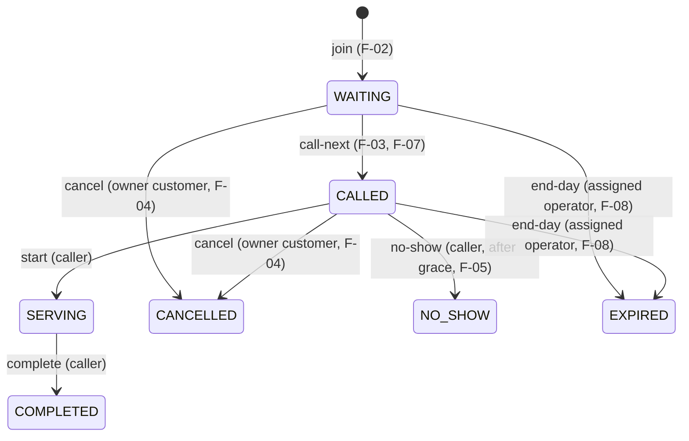

# Sprint 2 Engineering Contracts

**Status:** Contract set v1 - 2026-11-27 - plan Issue S2-1, branch `docs/sprint-2-3-contracts`
**Author:** WATHITx (Student B) - **Reviewer:** SinghLemonH (Student A)
**Sprint goal:** complete the customer and operator lifecycle and the branch-floor experience (F-04, F-05, F-06, F-07, F-08; F-03 contract v2).
**Baseline:** written against `faca7fb` (`Lab5-staging` head = `main` `cb02438`, tag `v0.3.0-lab7`: Sprint 1 + Labs 5, 6, 7). `sprint-2-staging` was created from this commit (D-25).

> **Issue numbering:** plan IDs are used below. GitHub numbers are added to `docs/sprints/plan.md` when the Issues are created.
>
> | Plan ID | S2-1 | S2-2 | S2-3 | S2-4 |
> |---|---|---|---|---|
> | Work | **these contracts** (+ Sprint 3 contracts) | F-07 + F-06 | F-04 + F-05 + F-08 | Sprint 2 release |
> | Author / Reviewer | B / A | A / B | B / A | B / A |

These files are the contract for Sprint 2. **No implementation commit for F-04..F-08 may land before this PR is merged into `sprint-2-staging`.** The merge commit of this PR is the "contract before implementation" evidence for Deliverable 2 Part B.

## 1. Files in this folder

| File | Content | Used by |
|---|---|---|
| [README.md](README.md) | Shared changes (state machine v2, errors, entry shape v2, endpoints, permissions, migration 002, config) and the feature contracts F-03 v2, F-04, F-05, F-07, F-06, F-08, plus the `/my-ticket` card design | S2-2, S2-3 |
| [sts.md](sts.md) | Software Test Specification: TEST-31..TEST-54, UT-05, UT-06, E2E-03, E2E-04 | S2-2, S2-3, S2-4 |
| [dod.md](dod.md) | Definition of Done for Sprint 2 feature PRs and the Sprint 2 release | S2-2, S2-3, S2-4 |

The Sprint 1 conventions in [`../sprint-1/README.md`](../sprint-1/README.md) section 3 (IDs, API conventions, error shape, response shapes, time, seed, test layout) still apply. This folder only lists what changes.

## 2. Sprint 2 scope at a glance

| Feature | Requirements | AC | Tests | Depends on | Issue |
|---|---|---|---|---|---|
| F-03 v2 Call-next with counter | FR-04, FR-09; BR-13; D-22 | (AC-42..AC-45) | TEST-42..TEST-45 | F-03 | S2-2 |
| F-04 Customer cancel | FR-06; BR-04, BR-11; D-07, D-17 | AC-31..AC-36 | TEST-31..TEST-36 (TEST-36 = E2E-03), UT-06 | F-02 | S2-3 |
| F-05 No-show | FR-07; BR-07, BR-12; D-14 | AC-37..AC-41 | TEST-37..TEST-41, UT-05, UT-06 | F-03 | S2-3 |
| F-07 Counters | FR-09; BR-13; D-22 | AC-42..AC-46 | TEST-42..TEST-46 | F-03 | S2-2 |
| F-06 Public board | FR-08; NFR-05; D-09 | AC-47..AC-49 | TEST-47..TEST-49 (TEST-49 = E2E-04) | F-07 | S2-2 |
| F-08 Open/close and end-of-day | FR-12; BR-09, BR-16; D-08, D-13 | AC-50..AC-54 | TEST-50..TEST-54, UT-06 | F-03 | S2-3 |

TDD items (red test committed before the implementation): **AC-38 / TEST-38 + UT-05** (F-05, grace-period boundary) and **AC-43 / TEST-43** (F-07, busy counter).

---

## 3. Shared contract changes

### 3.1 State machine v2 (completes D-04)



Transition table (`domain/entry-status.ts`, actions extended to `call | start | complete | cancel | noShow | expire`):

| From \ Action | call | start | complete | cancel | noShow | expire |
|---|---|---|---|---|---|---|
| WAITING | CALLED | 409 | 409 | CANCELLED | 409 | EXPIRED |
| CALLED | 409 | SERVING | 409 | CANCELLED | NO_SHOW (+ grace rule) | EXPIRED |
| SERVING | 409 | 409 | COMPLETED | 409 | 409 | not touched (D-27) |
| COMPLETED / CANCELLED / NO_SHOW / EXPIRED | 409 | 409 | 409 | 409 | 409 | not touched |

`cancel` and `expire` have **two** allowed source states, so `TRANSITIONS` becomes `Record<EntryAction, { from: EntryStatus[]; to: EntryStatus }>`. The Sprint 1 callers of `requiredStatus` keep working (or move to `allowedFrom(action): EntryStatus[]`). UT-01 must stay green.

Every terminal transition sets `ended_at = clock.now()` (D-28). `operator_id` and `counter_id` keep their values (history). Because `uq_operator_active_entry` and `uq_counter_active_entry` only cover CALLED/SERVING, a cancelled, no-show or expired CALLED entry **frees its operator and counter immediately**.

### 3.2 Error codes added (D-29)

| HTTP | Code | When | Feature |
|---|---|---|---|
| 409 | `NO_SHOW_TOO_EARLY` | no-show before `called_at + NO_SHOW_GRACE_MINUTES` | F-05 |
| 409 | `COUNTER_BUSY` | call-next with a counter that already has a CALLED/SERVING entry today | F-07 |

Existing codes are reused: `INVALID_TRANSITION` for every wrong status; `NOT_FOUND` for an unknown entry, another customer's entry and an unknown counter; `FORBIDDEN` for a wrong role or an unassigned queue; `NOT_ENTRY_OWNER` for an entry called by another operator; `VALIDATION_FAILED` for a bad body. New errors are subclasses of `DomainError` appended to `common/errors.ts`.

### 3.3 Entry response v2 (D-30)

```json
{
  "id": "uuid", "queueCode": "D", "displayNumber": "D004", "status": "CALLED",
  "lane": "REGULAR", "peopleAhead": null, "counterLabel": "Counter 1",
  "joinedAt": "...", "calledAt": "...", "startedAt": null, "endedAt": null
}
```
`counterLabel` is always present: the counter label when the entry was called with a counter, otherwise `null`. `ENTRY_SELECT` adds `LEFT JOIN counters c ON c.id = e.counter_id`. **TEST-10's exact key set must add `counterLabel` in the same commit** (S2-2), otherwise the Sprint 1 suite fails.

### 3.4 Endpoints added or changed in Sprint 2

| Method and path | Who | Body | Success | Feature |
|---|---|---|---|---|
| POST `/api/entries/:id/cancel` | Customer (owner) | none | 200 Entry (CANCELLED) | F-04 |
| POST `/api/entries/:id/no-show` | Operator (caller) | none | 200 Entry (NO_SHOW) | F-05 |
| GET `/api/queues/:code/counters` | Operator (assigned) | - | 200 `[{ "id", "label" }]` ordered by label | F-07 |
| POST `/api/queues/:code/call-next` (v2) | Operator (assigned) | optional `{ "counterId": uuid }` | 200 Entry (CALLED) | F-03 v2 / F-07 |
| GET `/api/public/board` | anyone (no session) | - | 200 Board | F-06 |
| PATCH `/api/queues/:code` | Operator (assigned) | `{ "isOpen": boolean }` | 200 QueueSummary | F-08 |
| POST `/api/queues/:code/end-day` | Operator (assigned) | none | 200 `{ "queue": QueueSummary, "expiredCount": n }` | F-08 |

Nest runs **guards → ValidationPipe → handler**, so rejections always come in this order: 401 (no session) → 403 `FORBIDDEN` (role) → 400 `VALIDATION_FAILED` (body) → handler checks (404 / 403 assignment / 403 owner / 409).

Every new endpoint except the board is appended to `apps/api/test/helpers/protected-endpoints.ts` (TEST-06, NFR-01), and its `feature` type union is widened.

### 3.5 Permissions matrix (Sprint 2 additions)

| Operation | Anonymous | Customer | Operator |
|---|---|---|---|
| Cancel entry | 401 | own WAITING/CALLED only (another customer's → 404) | 403 `FORBIDDEN` |
| No-show | 401 | 403 `FORBIDDEN` | entries they called in assigned queues (else 403 `NOT_ENTRY_OWNER` / `FORBIDDEN`) |
| List counters | 401 | 403 | assigned queues only |
| Call-next with counter | 401 | 403 | assigned queues; counter of that queue only |
| Public board | 200 | 200 | 200 |
| Open/close, end-day | 401 | 403 | assigned queues only |

### 3.6 Data: migration 002 and seed

`apps/api/src/infrastructure/migrations/1732600000000-Counters.ts` (timestamp greater than `1730800000000`; picked up by the existing glob for the CLI, tests and the deploy job):

```sql
CREATE TABLE counters (
  id       uuid PRIMARY KEY DEFAULT gen_random_uuid(),
  queue_id uuid NOT NULL REFERENCES queues(id) ON DELETE CASCADE,
  label    text NOT NULL CHECK (length(label) BETWEEN 1 AND 40),
  CONSTRAINT uq_counter_label UNIQUE (queue_id, label)
);
ALTER TABLE queue_entries ADD COLUMN counter_id uuid NULL REFERENCES counters(id);
CREATE UNIQUE INDEX uq_counter_active_entry
  ON queue_entries (counter_id, queue_date)
  WHERE status IN ('CALLED','SERVING') AND counter_id IS NOT NULL;
ALTER TABLE counters ENABLE ROW LEVEL SECURITY;
```
`down()` drops the index, the column, then the table. It is tested locally on an empty DB and on a DB with Sprint 1 data, plus one revert and re-run, before merging (the deploy job runs it on Supabase automatically). No other schema change in Sprint 2: every status already exists since migration 001 (D-15).

Seed changes:
- **Counters** (S2-2, function `seedCounters()` at the end of `seed.ts`, `ON CONFLICT (queue_id, label) DO NOTHING`): D → "Counter 1", "Counter 2"; L → "Counter 3"; O → "Counter 4".
- **Queue upsert fix** (S2-3, NFR-04): becomes `ON CONFLICT (code) DO UPDATE SET name = EXCLUDED.name`. It must **not** set `is_open = true`: the deploy job re-runs the seed, which would reopen a closed queue after every redeploy.

### 3.7 Configuration added

| Variable | Default | Used by |
|---|---|---|
| `NO_SHOW_GRACE_MINUTES` | 2 (integer ≥ 0; empty or invalid → 2) | F-05 |

Added to `.env.example` and the README variable table. If it is absent on Cloud Run, the default applies.

### 3.8 Decisions introduced by this contract

Recorded here first; copied into the SRS decision log (section 10) in plan Issue S3-2.

| ID | Decision | Reason |
|---|---|---|
| D-25 | Sprint 2 integrates on `sprint-2-staging`, created from `faca7fb` (the `Lab5-staging` head, equal to `main`). Sprint 3 integrates on `sprint-3-staging`, created from `main` after the `v0.4.0-sprint2` tag. `Lab5-staging` is kept for lab history only. `ci-docker.yml` runs on pull requests into all three staging branches and `main`; the required-check ruleset is extended to the two sprint branches | Follows the sprint flow in plan.md and system SDS 7 (`sprint-N-staging`); keeps each sprint's integration history separate |
| D-26 | Release tags `v0.4.0-sprint2`, `v0.5.0-rc1`, `v1.0.0`; annotated tag `v0.1.0-sprint1` created late on `0a2d8fe` | `v0.2.0` / `v0.3.0` are used by Labs 5 and 7; the Sprint 1 tag was never pushed |
| D-27 | End-of-day expires only **today's** WAITING and CALLED entries; SERVING is untouched | BR-16; never cut off a customer being served |
| D-28 | Cancel, no-show and expire set `ended_at = clock.now()` | Every terminal status has an end time (used by F-10) |
| D-29 | New error codes 409 `NO_SHOW_TOO_EARLY` and 409 `COUNTER_BUSY` | Distinct reasons so the UI shows the right message |
| D-30 | Entry response v2 adds `counterLabel: string \| null` | FR-09: the customer must know which counter to go to |

Open questions still in use with their defaults: **Q-02** (2-minute grace) for F-05; Q-01 belongs to Sprint 3.

---

## 4. Feature contracts

UI messages are given in English and Thai because the web app shows both (`lib/errors.ts`).

### 4.1 F-03 Operator service desk: contract v2 (call-next with counter)

**Requirements:** FR-04, FR-09, BR-13; D-22 · **Issue:** S2-2 · Only call-next changes.

Call-next workflow v2 (one transaction), in order:
1. (pipe) body is `{}` / absent / `{ counterId: <uuid> }`. Unknown field or non-UUID `counterId` → 400 `VALIDATION_FAILED`.
2. Unknown queue code → 404 `NOT_FOUND`.
3. Not assigned → 403 `FORBIDDEN`.
4. `counterId` given and not a counter **of this queue** → 404 `NOT_FOUND` ("This counter does not exist in this queue.").
5. Operator holds CALLED/SERVING today → 409 `OPERATOR_BUSY`.
6. `counterId` given and that counter has a CALLED/SERVING entry today → 409 `COUNTER_BUSY`.
7. Ordering policy → lock the lowest WAITING entry `FOR UPDATE SKIP LOCKED` → none → 409 `NO_WAITING_ENTRY`.
8. `UPDATE ... SET status='CALLED', operator_id=$me, called_at=$now, counter_id=$counterId (or NULL) WHERE id=$1 AND status='WAITING'`. A race on `uq_counter_active_entry` (23505) → `mapPgError` → 409 `COUNTER_BUSY`.

Without `counterId` the behavior is exactly Sprint 1 (`counterLabel: null`, BR-13 not applied, D-22), so every Sprint 1 test stays valid. The web UI **always** sends `counterId`.

**Layers:** Data: uses migration 002 (`counter_id`, `uq_counter_active_entry`). API: call-next accepts an optional body. UI: see F-07. Start, complete, assigned queues and current-entry: **no change**.

### 4.2 F-04 Customer cancel

**Requirements:** FR-06, BR-04, BR-11; D-07, D-17, D-28 · **AC:** AC-31..AC-36 · **Issue:** S2-3

**Workflow** `POST /api/entries/:id/cancel` (guards: session, role CUSTOMER):
1. `:id` not a UUID, unknown, or `customer_id ≠ me` → 404 `NOT_FOUND` (D-07: other customers' entries are never revealed).
2. Domain check: status not WAITING/CALLED → 409 `INVALID_TRANSITION`.
3. `UPDATE queue_entries SET status='CANCELLED', ended_at=$now WHERE id=$1 AND customer_id=$2 AND status IN ('WAITING','CALLED') RETURNING id`. 0 rows → 409 `INVALID_TRANSITION` (raced with call or start).
4. 200 Entry (CANCELLED).

| # | Case | Expected |
|---|---|---|
| E1 | Cancel a CALLED entry | Allowed; the calling operator's `current-entry` becomes `null`, they can call next, and the counter is free |
| E2 | Operator presses Start on an entry the customer just cancelled | 409 `INVALID_TRANSITION` (Sprint 1 logic, unchanged) |
| E3 | Rejoin after cancel the same day | Allowed (BR-02 v2 counts active entries only); new number at the end of the queue |
| E4 | `peopleAhead` of later entries | Decreases by 1 (only WAITING entries are counted) |
| E5 | Cancel an earlier-day WAITING entry | Allowed (own entry, valid transition); harmless |

**UI `/my-ticket`:** WAITING or CALLED → "Cancel ticket" secondary button → `window.confirm("Cancel ticket D004?")` → POST → reload. Terminal statuses show a link to `/queues`. Card layout: section 4.7.

| Code | EN | TH |
|---|---|---|
| `INVALID_TRANSITION` (cancel) | This ticket can no longer be cancelled. The page has been refreshed. | บัตรคิวนี้ยกเลิกไม่ได้แล้ว ระบบได้รีเฟรชหน้าให้ |

**Layers:** Data: **no schema change** (CANCELLED and `ended_at` exist since migration 001). API: one new endpoint. UI: `/my-ticket` only.

| AC | Expected outcome | Level | Test |
|---|---|---|---|
| AC-31 | Owner cancels own WAITING entry → 200, `status` CANCELLED, `endedAt` set; a later `GET /api/entries/:id` returns CANCELLED; the next entry's `peopleAhead` drops by 1 | API + DB | TEST-31 |
| AC-32 | Owner cancels own CALLED entry → 200 CANCELLED; the calling operator's `current-entry` is `{ entry: null }` and their next call-next is not `OPERATOR_BUSY` | API cross-feature | TEST-32 |
| AC-33 | Cancel a SERVING, COMPLETED or CANCELLED entry → 409 `INVALID_TRANSITION`; row unchanged | API | TEST-33 |
| AC-34 | Another customer's entry → 404 `NOT_FOUND` (row unchanged); an operator → 403 `FORBIDDEN`; no session → 401 | API | TEST-34 (+ TEST-06 row) |
| AC-35 | After cancelling, the same customer joins the same queue again the same day → 201 with a new display number | API cross-feature (BR-02 v2) | TEST-35 |
| AC-36 | UI: a customer joins, presses Cancel on `/my-ticket`, confirms, and sees the cancelled ticket card | E2E-03 | TEST-36 |

### 4.3 F-05 No-show handling

**Requirements:** FR-07, BR-04, BR-07, BR-12; D-14, D-20, D-28; Q-02 (open, default used) · **AC:** AC-37..AC-41 · **Issue:** S2-3 · **TDD:** AC-38

**Domain rule** (`domain/no-show-rule.ts`, pure functions, UT-05):
```ts
export function noShowAllowedAt(calledAt: Date, graceMinutes: number): Date; // calledAt + grace
export function isNoShowAllowed(calledAt: Date, now: Date, graceMinutes: number): boolean; // now >= allowedAt
```
Boundary: **exactly** `called_at + grace` is allowed; one second earlier is rejected.

**Workflow** `POST /api/entries/:id/no-show` (guards: session, role OPERATOR):
1. Malformed or unknown id → 404 `NOT_FOUND`.
2. The entry's queue is not assigned to the caller → 403 `FORBIDDEN`.
3. `operator_id` set and ≠ caller → 403 `NOT_ENTRY_OWNER`.
4. Status ≠ CALLED → 409 `INVALID_TRANSITION` (a WAITING entry has no caller and fails here, like Sprint 1 decision C-2).
5. `now < called_at + grace` → 409 `NO_SHOW_TOO_EARLY`.
6. `UPDATE ... SET status='NO_SHOW', ended_at=$now WHERE id=$1 AND status='CALLED' AND operator_id=$me RETURNING id`; 0 rows → 409 `INVALID_TRANSITION`.
7. 200 Entry (NO_SHOW). The operator and the counter are free.

**UI `/operator`** (`components/operator/NoShowButton.tsx`): the current-entry card in CALLED shows **No-show** next to Start, with the hint "No-show available from HH:MM" (computed from `calledAt` + 2; the server decides). After success the card clears.

| Code | EN | TH |
|---|---|---|
| `NO_SHOW_TOO_EARLY` | Please wait until the grace period has passed before marking no-show. | กรุณารอให้ครบเวลาก่อนบันทึกว่าลูกค้าไม่มา |

**Layers:** Data: **no schema change** (NO_SHOW, `called_at`, `ended_at` exist since migration 001). Config: `NO_SHOW_GRACE_MINUTES`. API: one new endpoint. UI: `NoShowButton` on `/operator`.

| AC | Expected outcome | Level | Test |
|---|---|---|---|
| AC-37 | With a fixed Clock at exactly `called_at + 2 min`, the calling operator marks no-show → 200 NO_SHOW, `endedAt` set; their next call-next is not `OPERATOR_BUSY` | API + DB | TEST-37 |
| AC-38 ★TDD | At `called_at + 1 min 59 s` → 409 `NO_SHOW_TOO_EARLY`; the row is still CALLED | API + unit | TEST-38, UT-05 |
| AC-39 | teller2 on teller1's entry → 403 `NOT_ENTRY_OWNER`; loanofficer1 → 403 `FORBIDDEN`; a customer → 403; no session → 401 | API | TEST-39 |
| AC-40 | No-show on a WAITING, SERVING or COMPLETED entry → 409 `INVALID_TRANSITION`; row unchanged | API + unit | TEST-40, UT-06 |
| AC-41 | UI: the CALLED card shows No-show; after the grace period it succeeds and the card clears | Manual (screenshot; a 2-minute wait in E2E is not practical) | TEST-41 |

### 4.4 F-07 Counters

**Requirements:** FR-09, BR-13; D-22, D-30 · **AC:** AC-42..AC-46 · **Issue:** S2-2 · **TDD:** AC-43

Call-next workflow: section 4.1. Counter list `GET /api/queues/:code/counters`: 404 unknown queue → 403 not assigned → 200 `[{ "id": "uuid", "label": "Counter 1" }]` ordered by label.

**UI `/operator`:** each assigned queue row has a counter `<select>` (`components/operator/CounterSelect.tsx`, filled from the list endpoint; the last choice per queue is remembered in `localStorage` inside try/catch). Call next sends `{ counterId }`. The current-entry card shows the counter label. **UI `/my-ticket`** (built in S2-3): CALLED → "Go to {counterLabel}" or "Go to the service desk" when `counterLabel` is null.

| Code | EN | TH |
|---|---|---|
| `COUNTER_BUSY` | This counter is already serving a customer. Choose another counter. | ช่องบริการนี้กำลังให้บริการลูกค้าอยู่ กรุณาเลือกช่องอื่น |

**Layers:** Data: migration 002 (section 3.6) + counter seed rows. API: call-next v2, new counter list endpoint, entry response v2. UI: `/operator` selector, `/my-ticket` counter text.

| AC | Expected outcome | Level | Test |
|---|---|---|---|
| AC-42 | teller1 calls next on D with Counter 1 → 200 CALLED, `counterLabel` "Counter 1"; the customer's `GET` shows the same label; `counter_id` is persisted | API + DB | TEST-42 |
| AC-43 ★TDD | While teller1's entry on Counter 1 is CALLED (and again while SERVING), teller2 calls with Counter 1 → 409 `COUNTER_BUSY` and no entry changes; after teller1 completes, teller2's call with Counter 1 succeeds | API | TEST-43 |
| AC-44 | A counter of queue L used on D, or an unknown counter UUID → 404 `NOT_FOUND`; `counterId: "abc"` or an extra field → 400 `VALIDATION_FAILED` | API | TEST-44 |
| AC-45 | Call-next without a body still returns CALLED with `counterLabel: null` (D-22 regression) | API | TEST-45 |
| AC-46 | Counter list: assigned operator → 200 with that queue's counters only; unassigned operator → 403; customer → 403; no session → 401 | API | TEST-46 |

### 4.5 F-06 Public board

**Requirements:** FR-08, NFR-05; D-09 · **AC:** AC-47..AC-49 · **Issue:** S2-2 · **Depends on:** F-07

`GET /api/public/board`: no guard, header `Cache-Control: no-store`. Response with **exactly** these keys (NFR-05):
```json
{
  "generatedAt": "2026-11-27T03:00:00.000Z",
  "queues": [
    {
      "code": "D", "name": "Deposit & Withdrawal", "isOpen": true, "waitingCount": 3,
      "nowServing": [
        { "displayNumber": "D004", "counterLabel": "Counter 1", "status": "CALLED", "lane": "REGULAR" }
      ]
    }
  ]
}
```
- `generatedAt` comes from the Clock. `queues` lists all queues ordered by `code`; `waitingCount` = today's WAITING entries.
- `nowServing` = today's CALLED and SERVING entries ordered by `called_at`. `lane` is included now so Sprint 3 only adds a badge.
- Never present: entry id, customer or operator id, username, display name, date of birth.

**UI `/board`** (`apps/web/src/app/board/page.tsx`, **outside** the `(app)` route group, so there is no signed-in header): large `tabular-nums` text, one column per queue, "D004 → Counter 1", the waiting count and a Closed badge; polls every 5 s; on an error it keeps the last data and shows "Reconnecting…". `/board` is **not** added to the middleware matcher (it is public).

**Layers:** Data: **no schema change** (reads migration 001/002 tables). API: one new public endpoint; no existing endpoint changes. UI: new `/board` page; no existing page changes.

| AC | Expected outcome | Level | Test |
|---|---|---|---|
| AC-47 | Without a session → 200; shows today's CALLED/SERVING entries with counter labels and correct waiting counts; COMPLETED, CANCELLED, NO_SHOW, EXPIRED and earlier-day entries are not listed | API + DB | TEST-47 |
| AC-48 | NFR-05: the key sets at every level equal exactly the contract above; the JSON text contains no UUID pattern, no seeded username and no display name | API | TEST-48 |
| AC-49 | UI: an operator selects Counter 2 and calls a customer; an anonymous browser context on `/board` shows the number with "Counter 2" within one refresh | E2E-04 | TEST-49 |

### 4.6 F-08 Queue open/close and end-of-day

**Requirements:** FR-12, BR-05, BR-09, BR-16; D-08, D-13, D-27, D-28 · **AC:** AC-50..AC-54 · **Issue:** S2-3

**`PATCH /api/queues/:code`**, body `{ "isOpen": boolean }` (DTO `SetQueueOpenDto`, `@IsBoolean()`, required; JSON only): 404 unknown queue → 403 not assigned → `UPDATE queues SET is_open=$1` → 200 QueueSummary. Idempotent (closing a closed queue → 200).

**`POST /api/queues/:code/end-day`** (one transaction):
1. 404 unknown queue → 403 not assigned.
2. `SELECT ... FROM queues WHERE id=$1 FOR UPDATE`; `UPDATE queues SET is_open=false`.
3. `UPDATE queue_entries SET status='EXPIRED', ended_at=$now WHERE queue_id=$1 AND queue_date=$today AND status IN ('WAITING','CALLED') RETURNING id`.
4. 200 `{ "queue": QueueSummary, "expiredCount": <rows> }`.

SERVING entries are not touched (D-27). Earlier-day leftovers are not touched (they never block anyone, D-13). Reopening after end-day is allowed; numbering continues from `last_seq` until midnight (BR-10).

**Known limitation (DEF-02):** a join that commits during an end-day transaction may leave one WAITING entry in the closed queue. Running end-day again expires it.

**UI `/operator`** (`components/operator/QueueControls.tsx`): each queue row has an Open/Closed badge, a "Close queue" / "Open queue" toggle and an "End of day" button with `confirm("End the day for D? All waiting and called tickets will expire.")`, followed by "N tickets expired." **`/queues`:** a closed queue shows the Closed badge and a disabled Join button. **`/my-ticket`:** EXPIRED uses the notice in section 4.7.

**Layers:** Data: **no schema change** (`is_open` and EXPIRED exist since migration 001); seed fix only (section 3.6). API: two new endpoints. UI: `QueueControls` on `/operator`, Closed badge on `/queues`, EXPIRED notice on `/my-ticket`.

| AC | Expected outcome | Level | Test |
|---|---|---|---|
| AC-50 | teller1 closes D → 200 `isOpen: false`; a customer's join on D → 409 `QUEUE_CLOSED`; `GET /api/queues` shows D closed; reopen → join 201 | API + DB | TEST-50 |
| AC-51 | Queue closed while a WAITING entry exists → call-next, start and complete still succeed (BR-09) | API | TEST-51 |
| AC-52 | End-day with 2 WAITING + 1 CALLED + 1 SERVING + 1 COMPLETED today and 1 WAITING yesterday → `expiredCount` 3; those 3 are EXPIRED with `endedAt`; SERVING, COMPLETED and yesterday's entry unchanged; queue closed; the operator who held the CALLED entry is free (`current-entry` is `{ entry: null }`) | API + DB | TEST-52 |
| AC-53 | Unassigned operator → 403 on PATCH and end-day; customer → 403; no session → 401; body `{}`, `{ "isOpen": "no" }` or an extra field → 400 `VALIDATION_FAILED`; unknown queue → 404 | API | TEST-53 |
| AC-54 | UI: an operator closes and reopens a queue; `/queues` shows the Closed badge and a disabled Join; end-of-day shows the expired count | Manual (screenshot) | TEST-54 |

UT-06 covers the full transition table in section 3.1 (every status × action pair).

### 4.7 `/my-ticket` ticket card design (UI spec v1.2)

**Issue:** S2-3 (same PR as F-04) · **Requirements:** FR-03 (display), FR-06, FR-09 · **Layers:** UI only; no API or data change. Visual rules: [`docs/ui-spec.md`](../../ui-spec.md) section 4.8.

The ticket looks like a movie ticket: **zigzag torn edges at the top and bottom**, a top part with the number, a dotted perforation line with half-circle notches on both sides, a notice part and a date footer.

| Part | Content |
|---|---|
| Card edges | Zigzag teeth on the top and bottom edges, cut with the CSS mask class `.ticket-edge` (`globals.css`). White card, **no border or shadow** (the mask would cut them unevenly); it stands out against the page background `#f2f1ec` |
| Top | "Your ticket number is" + Thai line "หมายเลขคิวของคุณ"; `displayNumber` in `text-6xl font-bold tabular-nums`; status badge (ui-spec 2.1); status line (table below); queue name · code in muted text |
| Perforation | `border-t-2 border-dotted border-stone-300 mx-4`; two circles `h-[22px] w-[22px] rounded-full bg-[#f2f1ec]`, positioned half past the left and right edges |
| Notice | Heading "Notice" in `text-amber-600 font-semibold`; one message per status, EN + TH |
| Footer | Calendar icon + the queue date `DD/MM/YYYY`, from `joinedAt` with `Intl.DateTimeFormat('en-GB', { timeZone: 'Asia/Bangkok' })` |
| Below the card | "Cancel ticket" secondary button for WAITING/CALLED (F-04); link to `/queues` for terminal statuses |

| Status | Status line | Notice (EN) | Notice (TH) |
|---|---|---|---|
| WAITING | "People ahead: N" | Please stay in the branch. Your number will be called at a counter. | กรุณารออยู่ในสาขา เราจะเรียกหมายเลขของคุณที่เคาน์เตอร์ |
| CALLED | "Go to {counterLabel}" or "Go to the service desk" | Please go to the counter now. Tickets not answered within 2 minutes may be marked no-show. | กรุณาไปที่เคาน์เตอร์ทันที หากไม่มาภายใน 2 นาที ระบบอาจบันทึกว่าไม่มา |
| SERVING | "Being served" | You are being served. | กำลังให้บริการคุณ |
| COMPLETED | "Completed" | Thank you for visiting. | ขอบคุณที่ใช้บริการ |
| CANCELLED | "Cancelled" | This ticket was cancelled. You can take a new number. | บัตรคิวนี้ถูกยกเลิกแล้ว คุณสามารถรับบัตรคิวใหม่ได้ |
| NO_SHOW | "No-show" | You were called but did not come. Take a new number if you still need service. | คุณไม่ได้มาตามที่เรียก หากยังต้องการรับบริการกรุณารับบัตรคิวใหม่ |
| EXPIRED | "Expired" | This ticket expired at the end of the day. | บัตรคิวนี้หมดอายุเมื่อสิ้นวัน |

The "2 minutes" in the CALLED notice is display text matching the default grace; the server stays the authority (F-05). In Sprint 3 a "Priority" badge sits next to the status badge (F-09).

```css
/* apps/web/src/app/globals.css: --t is the tooth size; the card needs vertical padding of at least --t */
.ticket-edge {
  --t: 8px;
  padding-block: var(--t);
  -webkit-mask:
    conic-gradient(from -45deg at bottom, #0000, #000 1deg 89deg, #0000 90deg) bottom / calc(2 * var(--t)) 51% repeat-x,
    conic-gradient(from 135deg at top, #0000, #000 1deg 89deg, #0000 90deg) top / calc(2 * var(--t)) 51% repeat-x;
  mask:
    conic-gradient(from -45deg at bottom, #0000, #000 1deg 89deg, #0000 90deg) bottom / calc(2 * var(--t)) 51% repeat-x,
    conic-gradient(from 135deg at top, #0000, #000 1deg 89deg, #0000 90deg) top / calc(2 * var(--t)) 51% repeat-x;
}
```
Usage: `<article data-testid="ticket" className="ticket-edge relative w-full max-w-sm bg-white text-center">`. The notch circles sit inside the card, so the mask (which only cuts the top and bottom) does not hide them.

**Must not break existing tests:** keep `data-testid="ticket"` on the card, and keep the display number and the texts "Waiting", "People ahead: {n}" and "Completed" inside it (asserted by `apps/web/e2e/sprint1-journey.spec.ts`). Keep the existing loading, empty and error states and the 5-second polling. No horizontal scroll at 375 px (Lab 6 #40).

---

## 5. Contract change procedure

Same as Sprint 1 ([`../sprint-1/README.md`](../sprint-1/README.md) section 5): edit the contract in the feature PR or a `docs/...` PR, bump the header to `Contract v2 - <date>`, add a version-history row with the reason and Issue/PR, update `sts.md` in the same commit if an AC or test changes, and never rewrite or squash the commit that introduced v1.

## 6. Version history

| Version | Date | Author | Change |
|---|---|---|---|
| v1 | 2026-11-27 | WATHITx | Initial Sprint 2 contract set (plan Issue S2-1): shared changes, F-03 v2, F-04, F-05, F-07, F-06, F-08, `/my-ticket` card design |
