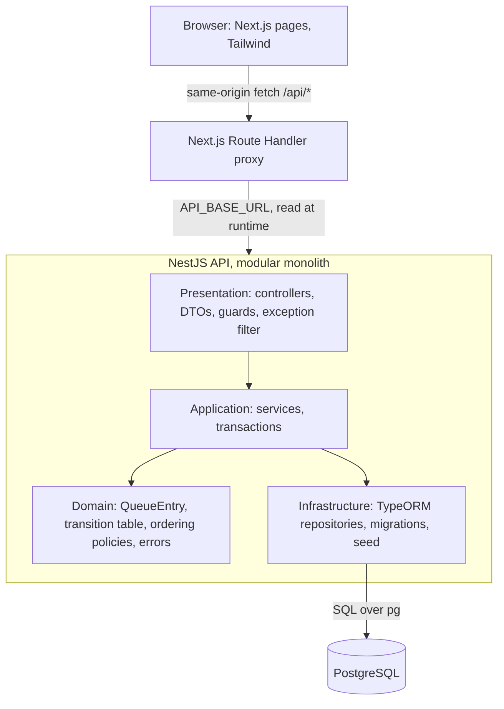
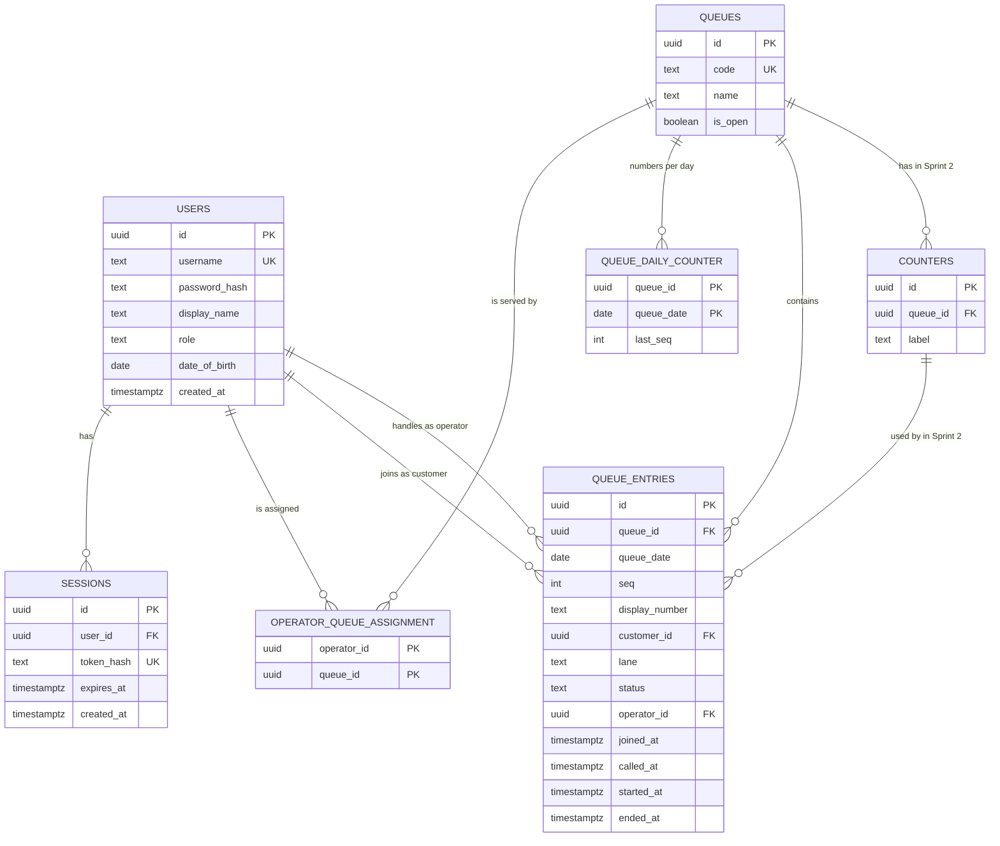
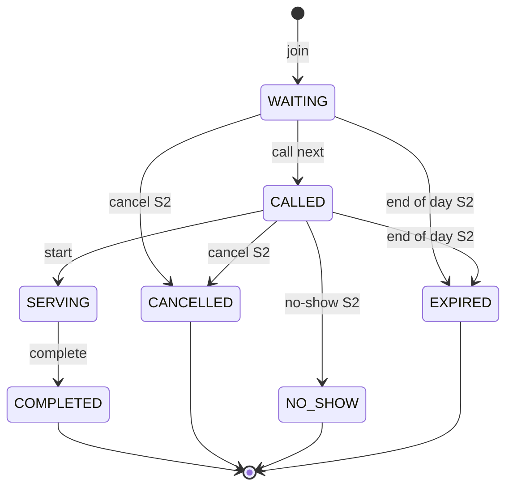
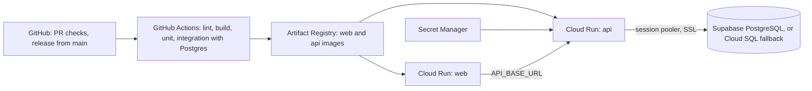

# System-Level SDS: Bank Branch Queue System

Version 1.0 (5 Nov 2026). Requirements are defined in `docs/srs.md`. Feature allocation is in `docs/features.md`. Detailed endpoint, screen and test contracts per feature are written in `docs/sprints/sprint-N/` before each feature is implemented; this document defines the conventions they follow.

---

## 1. Architecture and technology stack

### 1.1 Stack and rationale

| Layer | Choice | Responsibility and rationale |
|---|---|---|
| Runtime | Node.js 24 LTS (`.nvmrc`); `engines` accepts 22 to 24 | One version on both machines, in CI and in the Docker image. |
| Language | TypeScript (strict) in all workspaces | One language for UI and API; compile-time checks. |
| Frontend | Next.js (App Router), React, Tailwind CSS | Presentation only: screens, forms, status polling. No business rules and no database access. |
| Backend | NestJS 11 modular monolith | Controller, Service, Repository layering with dependency injection; domain classes hold the rules. |
| Validation | class-validator and class-transformer | Declarative DTO validation on every input with `whitelist`, `forbidNonWhitelisted` and `transform`. |
| Database | PostgreSQL 17 (Docker `postgres:17-alpine` locally; Supabase as plain PostgreSQL in Lab 5) | Durable storage; constraints and partial unique indexes are the last line of defense against races. |
| ORM and migrations | TypeORM 0.3 with `pg`, `synchronize: false` | Schema changes only through hand-written, ordered SQL migrations. |
| Authentication | Server-side sessions in the database, argon2id, `cookie-parser` | Immediately revocable sessions; no token in browser storage. |
| Tests | Jest, Supertest, `@nestjs/testing` (API tests use a real PostgreSQL database); Playwright for E2E | Real persistence and permission checks. |
| Repository layout | npm workspaces (`apps/api`, `apps/web`) | One repository, shared tooling. |
| Quality | ESLint and Prettier | Consistent code. |

Exact dependency versions are pinned in `package-lock.json` and listed in the README.

A modular monolith is used on purpose: the three logical layers (UI, API, database) need three runtime components but not microservices.

### 1.2 Component diagram



### 1.3 Communication

- The browser calls only same-origin `/api/*`. A Next.js Route Handler (`apps/web/src/app/api/[...path]/route.ts`) forwards each request to the NestJS API at `API_BASE_URL` (decision D-18). The session cookie therefore stays first-party and no CORS configuration is needed.
- `API_BASE_URL` is read at runtime, never baked in at build time, so one Docker image works in every environment. `next.config` rewrites are not used because they are frozen at build time in standalone builds.
- The API talks to PostgreSQL through TypeORM and `pg`.

### 1.4 Where business rules are enforced

| Concern | Enforced in | Not in |
|---|---|---|
| State transitions (BR-04), eligibility, grace period, ordering policy | Domain classes (`QueueEntry`, transition table, ordering policies) | Controllers, React components |
| Use cases and transactions (join, call-next, start, complete) | Application services | Controllers |
| Permissions (session, role, queue assignment, entry ownership) | Guards and application services | The UI (hidden buttons are cosmetic) |
| Uniqueness and race safety (BR-01, BR-02, BR-06, BR-13) | Database constraints and partial unique indexes, mapped to domain errors by constraint name | Application memory |
| Input shape | DTO validation | Services |

### 1.5 Layer rules

1. Business rules live in domain and application code, for example `QueueEntry.start(operatorId)`.
2. Controllers stay thin: DTO in, call a service, return the result. One global exception filter maps domain errors to HTTP responses.
3. The repository maps PostgreSQL error `23505` by constraint name to a domain error (for example `uq_active_entry_per_customer` to `DUPLICATE_ACTIVE_ENTRY`).
4. Constructor injection everywhere; repositories, `Clock` and `PasswordHasher` are injectable so tests can replace them.
5. All "now" values come from the injected `Clock` (D-20). `new Date()` is not called in domain or application code.
6. Inside a transaction every query uses the same `EntityManager` or `QueryRunner`. A call through the default pool would open a second connection and can deadlock under concurrency.
7. The API is stateless, reads all configuration from environment variables and writes no local files, so it is container-ready.

### 1.6 Code organization (API)

```
apps/api/src/
  domain/          queue-entry, entry-status (transition table), ordering/ (policy interface, FIFO; priority in Sprint 3)
  application/     auth.service, queue.service, service-desk.service
  infrastructure/  entities, repositories, migrations, seed, data-source, password-hasher
  presentation/    controllers, dto, guards, decorators
  common/          clock, errors, http-exception.filter (shared by all layers)
  app.module.ts, main.ts
```

Sprint 1 has three feature modules: Auth, Queue and ServiceDesk.

---

## 2. Data model

### 2.1 Entity-relationship diagram



### 2.2 Entities, ownership and key constraints

| Table | Purpose | Ownership and relationships | Important constraints |
|---|---|---|---|
| `users` | Login accounts for both roles | Referenced by sessions, assignments and entries | `username` unique; `role` is `CUSTOMER` or `OPERATOR`; customers must have `date_of_birth` (`ck_customer_dob`) |
| `sessions` | Server-side login sessions | Belongs to one user; deleted with the user | `token_hash` unique (only the SHA-256 of the token is stored); `expires_at` required |
| `queues` | One queue per service type (D, L, O) | Parent of entries and counters | `code` is one capital letter and unique; `is_open` defaults to true |
| `operator_queue_assignment` | Which operators may act on which queues | Composite key (operator, queue); implements BR-05 | Primary key prevents duplicates |
| `queue_daily_counter` | Last sequence number used per queue per day | Composite key (queue, date) | `last_seq >= 0`; incremented atomically at join |
| `queue_entries` | One customer's place in one queue on one date | Owned by `customer_id`; `operator_id` is set when called | See below |
| `counters` (Sprint 2) | Named service points | Belongs to a queue | `UNIQUE(queue_id, label)` |

Constraints on `queue_entries`:

| Constraint | Rule enforced |
|---|---|
| `uq_entry_number` unique on (queue, date, seq) | BR-01 unique numbers per queue per day |
| `uq_active_entry_per_customer` unique on (queue, date, customer) where status is WAITING, CALLED or SERVING | BR-02 one active entry per queue per day |
| `uq_operator_active_entry` unique on (operator, date) where status is CALLED or SERVING | BR-06 one held entry per operator |
| `ck_operator_required`: status other than WAITING, CANCELLED, EXPIRED requires `operator_id` | An entry past WAITING always has an owner (BR-07) |
| `status` check list and `lane` check list | Only known values; all seven statuses and both lanes exist from migration 001 (D-15) |
| `seq > 0` | Sequences start at 1 |
| `ix_waiting` on (queue, date, lane, seq) where status is WAITING | Fast call-next lookup, lane-aware for Sprint 3 |
| `uq_counter_active_entry` unique on (counter, date) where CALLED or SERVING (Sprint 2, migration 002) | BR-13 |

The data model has no field for money, account numbers, balances, amounts or national ID numbers (BR-08, D-11).

### 2.3 State machine



| Transition | Actor | Sprint | Extra conditions |
|---|---|---|---|
| (none) to WAITING | Customer | 1 | Queue open; no active entry in this queue today |
| WAITING to CALLED | Operator | 1 | Assigned queue; operator holds no entry; lowest eligible entry |
| CALLED to SERVING | Calling operator | 1 | Operator owns the entry |
| SERVING to COMPLETED | Calling operator | 1 | Operator owns the entry |
| WAITING or CALLED to CANCELLED | Customer (owner) | 2 | Own entry only |
| CALLED to NO_SHOW | Calling operator | 2 | At least the grace period after `called_at` |
| WAITING or CALLED to EXPIRED | Operator (end-of-day) | 2 | Assigned queue; entries of that day |

Every other pair is rejected with `INVALID_TRANSITION` and changes no data (BR-04).

### 2.4 Key transactions

**Join (one transaction).**
1. Load the queue by code (404 if missing). If closed, 409 `QUEUE_CLOSED`.
2. Pre-check for an active entry today in this queue: 409 `DUPLICATE_ACTIVE_ENTRY`.
3. Increment the daily counter with a single atomic `INSERT ... ON CONFLICT DO UPDATE ... RETURNING last_seq`.
4. Insert the entry (lane REGULAR in Sprint 1; computed from the date of birth in Sprint 3). `queue_date` and `joined_at` come from the Clock.
5. If a race triggers `23505` on `uq_active_entry_per_customer`, map it to `DUPLICATE_ACTIVE_ENTRY`. The rollback also undoes the counter increment, so numbers have no gaps.

**Call next (one transaction).**
1. Check the queue assignment (403 `FORBIDDEN`).
2. Check the operator holds nothing today (409 `OPERATOR_BUSY`; the unique index catches races).
3. Ask the ordering policy which lane to take, then select the lowest-sequence WAITING entry with `FOR UPDATE SKIP LOCKED`, so two operators never receive the same entry.
4. None found: 409 `NO_WAITING_ENTRY`.
5. Conditional update to CALLED with the operator and `called_at` from the Clock.

**Start and complete.** Load the entry (404), check queue assignment (403), check the operator owns it (403 `NOT_ENTRY_OWNER`), check the transition in the domain (409 `INVALID_TRANSITION`), then a conditional update (`WHERE id = ? AND status = ? AND operator_id = ?`); zero rows updated means `INVALID_TRANSITION`.

**Priority ordering (Sprint 3 design, interface exists from Sprint 1).** A `QueueOrderingPolicy` returns which lane to take next given the recent called lanes and which lanes have waiting entries. Sprint 1 uses `FifoOrderingPolicy`; Sprint 3 adds `PriorityOrderingPolicy` and locks the queue row before choosing, so concurrent operators keep the anti-starvation count correct.

### 2.5 Database setup, migrations and seed

| Task | Command | Notes |
|---|---|---|
| Start PostgreSQL | `npm run db:up` | `docker-compose.yml` runs `postgres:17-alpine`; `docker/init-db.sql` also creates the test database `queue_system_test` |
| Apply migrations | `npm run db:migrate` | Migration 001 creates every Sprint 1 table, constraint and index, and enables row-level security on all tables |
| Seed demo data | `npm run db:seed` | Idempotent; can be re-run safely |
| Reset | `npm run db:reset` | Development only |

Planned migrations: 002 (Sprint 2) adds `counters`, `queue_entries.counter_id` and `uq_counter_active_entry`; 003 (Sprint 3, optional) adds a reporting index on (queue, date, status).

Seed data is synthetic and reproducible:

| Item | Content |
|---|---|
| Queues | D Deposit & Withdrawal, L Loans, O Account Opening (all open) |
| Operators | teller1 and teller2 on D, loanofficer1 on L, accountofficer1 on O |
| Customers | customer1 (born 1948-03-15), customer2 (1995-07-02), customer3 (2001-12-20), customer4 (1950-09-09) |
| Passwords | One demo password from the environment variable `SEED_DEMO_PASSWORD`, hashed with argon2id at seed time |

Automated tests create their own fixtures (for example 20 extra customers for the concurrency test) and do not depend on the demo seed. Migration 001 enables row-level security with no policies, so if the database is exposed through a hosted data API the anonymous and authenticated roles see nothing; the backend connects as the table owner and is unaffected.

---

## 3. API conventions

| Topic | Convention |
|---|---|
| Prefix and format | All endpoints under `/api`; JSON only. Endpoints with a JSON body reject other content types with 415. |
| Identifiers | Queues by code in paths (`/api/queues/D/...`, D-16); users, entries and sessions by UUID. |
| Validation | DTO validation on every input; unknown fields are rejected (400 `VALIDATION_FAILED`). |
| Success codes | 200 and 201 for results, 204 for no content. |
| Error shape | One global filter returns `{ "error": { "code": "...", "message": "..." } }`. Stack traces, SQL and internal details are never returned. |
| Methods | State changes use POST or PATCH, never GET. |

| HTTP | Code | Meaning |
|---|---|---|
| 400 | `VALIDATION_FAILED` | Malformed or unknown input |
| 401 | `UNAUTHENTICATED`, `INVALID_CREDENTIALS` | No valid session; failed login |
| 403 | `FORBIDDEN`, `NOT_ENTRY_OWNER` | Wrong role, unassigned queue, or entry held by another operator |
| 404 | `NOT_FOUND` | Missing record, or another customer's entry (D-07) |
| 409 | `QUEUE_CLOSED`, `DUPLICATE_ACTIVE_ENTRY`, `INVALID_TRANSITION`, `OPERATOR_BUSY`, `NO_WAITING_ENTRY` | Business-rule conflicts |

Entry response shape: `{ id, queueCode, displayNumber, status, lane, peopleAhead, joinedAt, calledAt, startedAt, endedAt }`. `peopleAhead` is present only for WAITING entries; `counterLabel` is added in Sprint 2. The current-user response is `{ id, username, displayName, role }` and never contains the password hash or date of birth.

### 3.1 Endpoint list

| Method and path | Who | Result | Sprint |
|---|---|---|---|
| POST `/api/auth/login` | anyone | 200 and cookie, or 401 | 1 |
| POST `/api/auth/logout` | logged in | 204 | 1 |
| GET `/api/auth/me` | logged in | 200 current user | 1 |
| GET `/api/queues` | logged in | Queues with waiting counts | 1 |
| POST `/api/queues/:code/entries` | Customer | 201 entry, 404, 409 | 1 |
| GET `/api/me/entries` | Customer | Own entries for today | 1 |
| GET `/api/entries/:id` | Customer (own) | 200 or 404 | 1 |
| GET `/api/operator/queues` | Operator | Assigned queues with waiting counts | 1 |
| GET `/api/operator/current-entry` | Operator | Held entry or `null` | 1 |
| POST `/api/queues/:code/call-next` | Operator (assigned) | 200 CALLED entry, 403, 409 | 1 |
| POST `/api/entries/:id/start` | Operator (caller) | 200 SERVING, 403, 404, 409 | 1 |
| POST `/api/entries/:id/complete` | Operator (caller) | 200 COMPLETED, 403, 404, 409 | 1 |
| POST `/api/entries/:id/cancel` | Customer (own) | 200 CANCELLED, 404, 409 | 2 |
| POST `/api/entries/:id/no-show` | Operator (caller) | 200 NO_SHOW, 403, 409 | 2 |
| PATCH `/api/queues/:code` with `{isOpen}` | Operator (assigned) | 200 | 2 |
| POST `/api/queues/:code/end-day` | Operator (assigned) | 200 with `{expiredCount}` | 2 |
| GET `/api/public/board` | anyone | Per queue: code, name, now-serving numbers with counter labels, waiting count | 2 |
| GET `/api/queues/:code/summary?from=&to=` | Operator (assigned) | Summary numbers | 3 |

In Sprint 2, call-next also accepts an optional `{ counterId }` (D-22).

---

## 4. UI structure and conventions

### 4.1 Screens and navigation

| Screen | Audience | Content | Sprint |
|---|---|---|---|
| `/login` | Anyone | Username and password form | 1 |
| `/queues` | Customer | Queue list with waiting counts and a Join button per queue | 1 |
| `/my-ticket` | Customer | Display number, status, people ahead; refreshes every 5 seconds | 1 |
| `/operator` | Operator | Assigned queues with waiting counts, the current entry, and Call next, Start, Complete according to state | 1 |
| `/board` | Anyone | Public board with large text and auto-refresh | 2 |
| `/my-ticket` (cancel), `/operator` (no-show, open/close, end-of-day, counter selector) | Customer, Operator | Additional actions | 2 |
| Priority badge on `/my-ticket`, `/operator`, `/board`; `/operator/summary` | Customer, Operator | Lane indicator and summary table | 3 |

Navigation: after login a customer lands on `/queues` and an operator on `/operator`. The navigation bar shows only the links for the current role. This is cosmetic only; the API enforces permissions.

### 4.2 Shared UI behavior

1. **One API client** (`lib/api.ts`) calls `fetch('/api/...', { credentials: 'include' })` and returns typed results or typed errors.
2. **Error mapping in one place** (`lib/errors.ts`): each API error code maps to one friendly message (for example `DUPLICATE_ACTIVE_ENTRY` to "You already have an active ticket for this queue").
3. **Every screen handles four states:**

| State | Behavior |
|---|---|
| Loading | Skeleton or spinner; action buttons disabled |
| Empty | Explanatory text (no queues, nothing waiting, no current entry) |
| Error | Friendly message from the error map; retry action; no raw error text |
| Success | Data shown; after a rejected action the screen stays usable |

4. **Validation:** forms validate required fields before submitting; the server remains the authority.
5. **Session handling:** a 401 from any call redirects to `/login`. The route guard in Next.js redirects visitors without a `sid` cookie to `/login` as a convenience only. The file is `src/middleware.ts` on the installed Next.js 15 and `src/proxy.ts` on Next.js 16.
6. **Refresh behavior:** `/my-ticket`, `/board` and `/operator` poll; the operator screen restores the held entry from `GET /api/operator/current-entry` after a reload (D-21).

---

## 5. Authentication, sessions and authorization

### 5.1 Credential handling and session lifecycle

| Step | Behavior |
|---|---|
| Login | `POST /api/auth/login` with username and password. The server verifies the argon2id hash, creates a random 32-byte token, stores only `sha256(token)` in `sessions` with `expires_at`, and sets cookie `sid`. |
| Cookie | HttpOnly, `SameSite=Lax`, `Path=/`, `Max-Age` equal to the session lifetime, `Secure` when `COOKIE_SECURE=true` (HTTPS deployments). |
| Lifetime | `SESSION_TTL_HOURS`, default 8. |
| Current user | `GET /api/auth/me` resolves the user from the cookie only; the client never sends a user id or role. |
| Expiry | A session past `expires_at` returns 401 and its row is deleted on sight. |
| Logout | `POST /api/auth/logout` deletes the session row and clears the cookie; the old token then returns 401. |
| Failed login | Always 401 `INVALID_CREDENTIALS` with an identical body whether or not the username exists; no cookie is set. |
| Password storage | argon2id hash only. Hashing sits behind an injectable `PasswordHasher`; tests use low cost parameters, production uses the library defaults. |

### 5.2 Authorization order

Guards and checks run in this order, and the first failure decides the response:

1. `SessionAuthGuard`: no valid session gives 401.
2. `RolesGuard` with `@Roles('CUSTOMER' | 'OPERATOR')`: wrong role gives 403.
3. Service-level checks: operator queue assignment (403), customer entry ownership (404), operator entry ownership (403 `NOT_ENTRY_OWNER`).

### 5.3 Role and permission matrix

| Operation | Anonymous | Customer | Operator | Sprint |
|---|---|---|---|---|
| Login | yes | yes | yes | 1 |
| Logout, current user | 401 | yes | yes | 1 |
| List queues | 401 | yes | yes | 1 |
| Join a queue | 401 | yes | 403 | 1 |
| View own entries or one entry | 401 | own only (others 404) | 403 | 1 |
| View assigned queues and current entry | 401 | 403 | own only | 1 |
| Call next | 401 | 403 | assigned queues only | 1 |
| Start or complete an entry | 401 | 403 | only entries they called | 1 |
| Cancel an entry | 401 | own WAITING or CALLED only | 403 | 2 |
| Mark no-show | 401 | 403 | only entries they called | 2 |
| Open or close a queue, end-of-day | 401 | 403 | assigned queues only | 2 |
| Public board | yes (limited fields) | yes | yes | 2 |
| Service summary | 401 | 403 | assigned queues only | 3 |

### 5.4 Record-level access

| Record | Who may read or change | Rule |
|---|---|---|
| Queue entry | The owning customer reads it; the calling operator changes it | Another customer receives 404 (D-07); another operator receives 403 `NOT_ENTRY_OWNER` |
| Queue | Operators assigned to it act on it | Unassigned queue gives 403 |
| Session, user record | Only the server | Never exposed; the password hash and date of birth are never returned |

### 5.5 CSRF stance (conscious decision)

The `SameSite=Lax` cookie is not sent on cross-site POST requests. State changes never use GET. Endpoints that take a JSON body reject other content types with 415. Body-less POSTs (logout, call-next, start, complete) rely on `SameSite=Lax`. There is no CSRF token in this project; a token is a known hardening option.

---

## 6. Configuration and secrets

All configuration comes from environment variables. `.env.example` is committed with development placeholders only; `.env` is git-ignored.

| Variable | Used by | Purpose | Notes |
|---|---|---|---|
| `NODE_ENV` | api, web | Environment mode | |
| `PORT` | api | API listen port | 3001 locally |
| `API_BASE_URL` | web | Target of the Route Handler proxy | Read at runtime |
| `WEB_PORT` | web | Web dev server port | 3000 locally |
| `DATABASE_HOST`, `DATABASE_PORT`, `DATABASE_USER`, `DATABASE_PASSWORD`, `DATABASE_NAME` | api | Database connection | In deployment these come from Secret Manager |
| `DATABASE_NAME_TEST` | api tests | Separate test database | Tests never run against the development or cloud database |
| `DATABASE_SSL` | api | Require SSL | `true` for Supabase |
| `SESSION_TTL_HOURS` | api | Session lifetime | Default 8 |
| `COOKIE_SECURE` | api | `Secure` flag on the cookie | `true` on HTTPS (Cloud Run) |
| `SEED_DEMO_PASSWORD` | seed | Demo account password | Synthetic; set locally; must not be a real password |
| `APP_TIMEZONE` | api | Branch time zone | `Asia/Bangkok`; planned |
| `NO_SHOW_GRACE_MINUTES` | api | No-show grace period | Default 2; Sprint 2 |
| `PRIORITY_AGE`, `PRIORITY_STREAK_LIMIT` | api | Priority eligibility age and anti-starvation limit | Defaults 60 and 3; Sprint 3 |

Secret handling rules (NFR-07):

1. No real secret, token or password appears in Git, the PDF or client code. Only `.env.example` is committed.
2. Demo credentials are synthetic and shared with the course staff through the private handoff or the documented seed procedure.
3. In deployment, database credentials live in Secret Manager and are injected as environment variables; nothing is baked into images.
4. The browser never receives a database credential or a session secret; the only browser-visible credential is the HttpOnly session cookie.

---

## 7. Delivery and deployment plan

### 7.1 Deliverable 1 (local)

The release runs locally: `docker compose` provides PostgreSQL, the API and web run with `npm run dev:api` and `npm run dev:web`, and the build and test commands run from the repository root (`npm run build`, `npm test`, `npm run test:e2e`). Docker packaging of the application, CI/CD and GCP deployment are completed in Lab 5; this design keeps them possible.

### 7.2 Planned deployment (Lab 5 onwards)



| Component | Plan |
|---|---|
| Images | Two Dockerfiles on `node:24-slim`; Next.js built with `output: 'standalone'`; no secrets in images |
| CI | GitHub Actions on every PR: lint, build, unit tests, integration tests with a PostgreSQL service container; required checks protected by branch protection |
| CD | Deploy from `main` only, after a reviewed release PR and an annotated tag; migrations run as a pipeline step before the API is deployed |
| Hosting | Two Cloud Run services (web, api) in the region closest to the database (for example Singapore) |
| Database | Supabase as plain PostgreSQL through the session pooler (port 5432, SSL on); Cloud SQL if the TA does not accept an external database (SRS Q-04) |
| Secrets | Secret Manager for database credentials; `COOKIE_SECURE=true` |
| Persistence check | Data created before a redeployment is still present afterwards (NFR-04) |
| Cautions | Automated tests never run against the cloud database; free Supabase projects pause when idle, so check before demos and UAT |

### 7.3 Branching and release flow

`main` is the released line. `sprint-N-staging` integrates reviewed work. Feature, fix, docs and chore branches start from the current staging branch and are merged by pull request with a merge commit only (D-23), after review by the other student. A reviewed release PR merges staging into `main`, followed by an annotated tag (`v0.1.0-sprint1`, `v0.2.0-sprint2`, `v1.0.0`). Lab work uses patch releases from staging (D-24).

---

## 8. Testing approach (summary)

| Level | Tool | Scope |
|---|---|---|
| Unit | Jest | Transition table, display number, `queueDate()`, ordering policy |
| API and database integration | Jest, Supertest, real PostgreSQL | Persistence, permissions, concurrency, restart; run in band with a truncate before each test file |
| End-to-end | Playwright | Login and role redirect (E2E-01); customer joins and operator serves (E2E-02) |

Tests override the Clock with a fixed time, use a low-cost password hasher, and use `Promise.all` of real HTTP requests for the concurrency tests. Test names start with their ID (for example `TEST-11 / AC-11: ...`). Rule work follows test-first evidence: failing test, saved output, implementation, saved passing output. Per-feature test specifications are written in the Sprint contracts.

---

## 9. Known limitations and hardening options

| Item | Status |
|---|---|
| No CSRF token (relies on `SameSite=Lax`) | Documented decision (section 5.5); token is a hardening option |
| No login rate limiting or lockout | Out of scope for this course project; seeded accounts only |
| Polling instead of push updates | Accepted (assumption A-07) |
| SSL certificate verification against Supabase | Verify with the provider certificate if possible; if verification is disabled, record it as technical debt |
| `SESSION_SECRET` appears in `.env.example` but the session design does not use it (tokens are random and stored hashed) | Cleanup: remove it or document its purpose |
| `SEED_DEMO_PASSWORD` has a placeholder value in `.env.example` | Acceptable only as a synthetic development value; real or shared passwords must never be committed |
